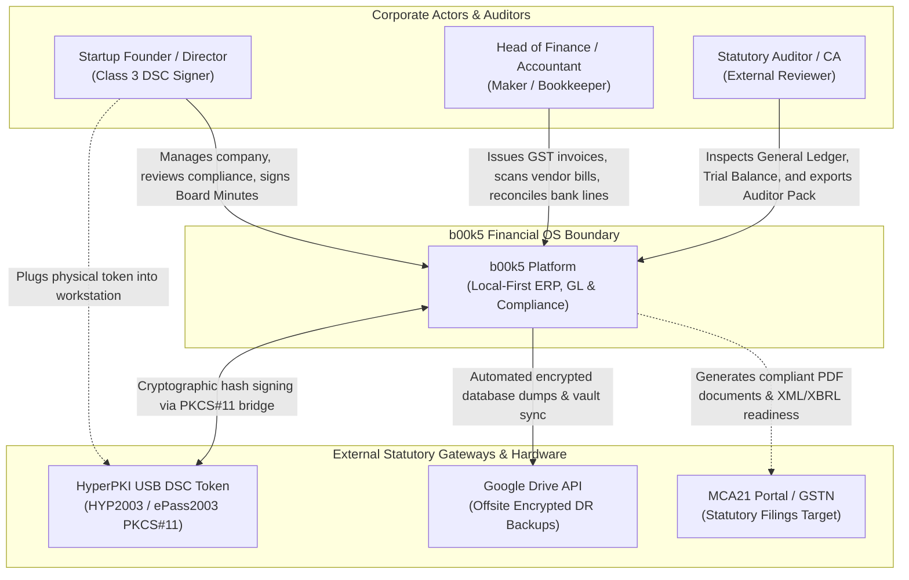
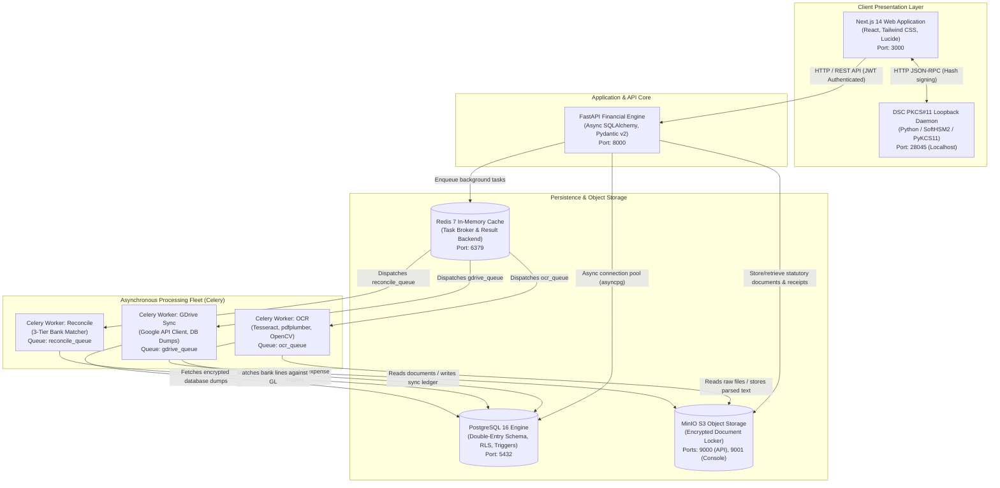
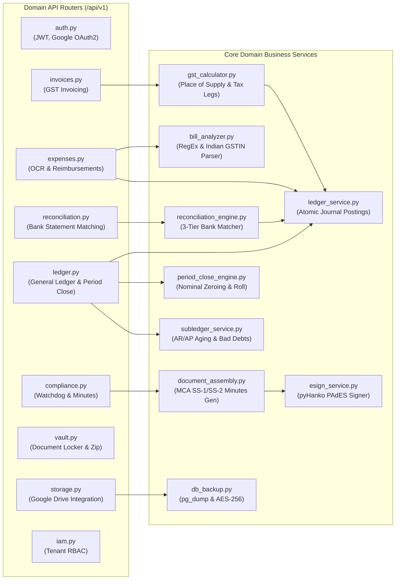
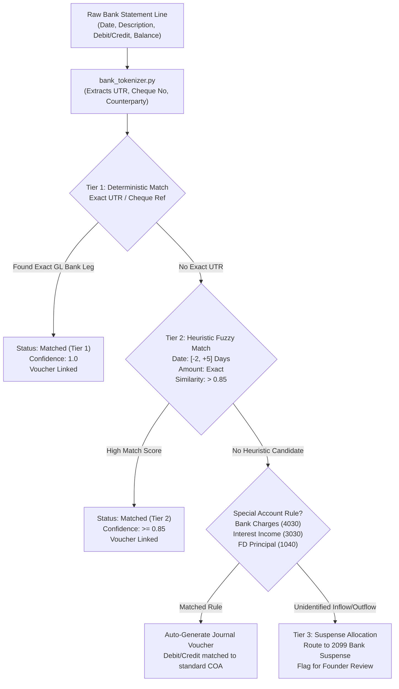
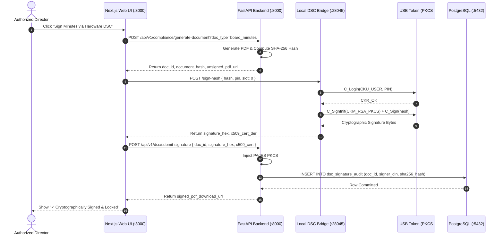

# b00k5 System Architecture & Engineering Blueprint

## 1. Executive Architecture Summary

**b00k5** is an open-source, local-first, multi-tenant financial operating system, general ledger, statutory compliance engine, and legal document vault designed specifically for Indian corporate entities (Private Limited, One Person Companies, and LLPs) operating under the **Companies Act, 2013**, **Central Goods and Services Tax (CGST) Act, 2017**, and the **Income-tax Act, 1961**.

The architecture adheres to four foundational engineering imperatives:
1. **Mathematical Inviolability:** General Ledger double-entry invariant $\sum \text{Debits} \equiv \sum \text{Credits}$ enforced at the database transaction level via triggers. Float arithmetic is strictly prohibited; all currency calculations utilize arbitrary-precision decimals (`Decimal(15, 2)`) with Banker's Rounding (`ROUND_HALF_EVEN`).
2. **Tenant Isolation via Row-Level Security (RLS):** Complete multi-tenant partitioning in PostgreSQL where every table enforces `tenant_id` scoping via PostgreSQL session variables (`app.current_tenant_id`) and forced RLS policies.
3. **Hardware-Anchored Secretarial Cryptography:** Class-3 Digital Signature Certificate (DSC) signing performed on the client director's workstation via a localhost PKCS#11 loopback bridge (`http://127.0.0.1:28045`), ensuring private cryptographic keys never transit network boundaries.
4. **Statutory Watchdog Automation:** Real-time countdown tracking and compounding fine calculators for mandatory Indian corporate compliance (INC-20A, DIR-3 KYC, AOC-4, MGT-7, and Section 173 Board Meeting intervals).

---

## 2. C4 Architecture Specification

### 2.1 C4 Level 1: System Context Diagram

The System Context diagram details how human actors and external statutory systems interact with the b00k5 platform boundaries.



---

### 2.2 C4 Level 2: Container Diagram

The Container diagram illustrates the runtime microservices, data stores, worker queues, and reverse-proxy components.



---

### 2.3 C4 Level 3: Component Diagram (FastAPI Financial Engine)

Inside the FastAPI Container (`apps/api/app`), modules are partitioned into decoupled domain routers, dependencies, and business domain engines:



---

## 3. Core Business Logic & State Machines

### 3.1 Double-Entry General Ledger Invariant Engine

The General Ledger relies on an inviolable mathematical guarantee:
$$\sum_{i=1}^{n} \text{Debit}_i = \sum_{j=1}^{m} \text{Credit}_j$$

Every financial event in b00k5 is mapped to balanced journal lines:
1. **Invoice Issuance (Quote-to-Cash):**
   * **Debit:** `Accounts Receivable (Code 1020)` for Grand Total
   * **Credit:** `Operating SaaS/Consulting Revenue (Code 3010/3020)` for Subtotal
   * **Credit:** `Output CGST (Code 2050)` & `Output SGST (Code 2051)` (if Intra-state) OR `Output IGST (Code 2052)` (if Inter-state)
2. **Founder Personal Expense (Procure-to-Pay):**
   * **Debit:** `Expense Account (Code 4010-4090)` for Base Cost
   * **Debit:** `Input GST Credit (Code 1030-1032)` for Input Tax
   * **Credit:** `Director Reimbursements Payable (Code 2105)` for Grand Total
3. **Database-Level Trigger (`check_zero_sum_balance`):**
   * Executed at transaction commit (`CONSTRAINT TRIGGER DEFERRABLE INITIALLY DEFERRED`).
   * Computes discrepancy $\delta = |\sum \text{Debit} - \sum \text{Credit}|$. If $\delta > 0.00$, the transaction aborts with an uncatchable SQL `RAISE EXCEPTION`.

```mermaid
stateDiagram-v2
    [*] --> Draft : Draft Invoice / Expense Created
    Draft --> Validated : Mod-36 GSTIN & Tax Verified
    Validated --> Committed : Atomic DB Transaction Open
    state Committed {
        PostDebitLeg --> PostCreditLeg
        PostCreditLeg --> EvaluateZeroSumTrigger
        EvaluateZeroSumTrigger --> AbortRollback : Discrepancy > 0.00
        EvaluateZeroSumTrigger --> LedgerWritten : Discrepancy == 0.00
    }
    AbortRollback --> Draft : Raise Error 400
    LedgerWritten --> Posted : Immutable Journal Voucher Generated
    Posted --> [*]
```



---

### 3.2 3-Tier Bank Reconciliation Engine

The reconciliation engine processes ingested bank statements (PDF, CSV, Excel) through a deterministic 3-tier cascade:



---

### 3.3 Hardware DSC Token Signing Lifecycle (MCA Secretarial Standards)

In strict accordance with the Information Technology Act, 2000 and MCA Secretarial Standards (SS-1 and SS-2):
1. **Document Assembly:** FastAPI compiles dynamic HTML/CSS Board Meeting Minutes or Resolutions with the official Corporate Letterhead (CIN, Registered Office, Board Attendance).
2. **PDF Compilation & SHA-256 Digest:** The document is rendered into an immutable PDF, and its SHA-256 hash digest is generated.
3. **Localhost PKCS#11 Loopback Request:** The browser contacts `http://127.0.0.1:28045/sign-hash`.
4. **Hardware Execution:** The local bridge accesses the HyperPKI HYP2003 / ePass2003 USB token via native dynamic driver (`libespki.dylib`, `libespki.so`, or `eps2003csp11.dll`), authenticates the User PIN, and performs RSA-2048 signing on-chip.
5. **PAdES Timestamp & Cryptographic Audit:** The signature is injected into the PDF via pyHanko, verified against the public X.509 certificate, and recorded in `dsc_signature_audit`.



---

## 4. Multi-Tenant Row-Level Security (RLS) Engine

Multi-tenancy in b00k5 does not rely on application-level `WHERE tenant_id = ...` filters, which are susceptible to developer error. Instead, security is enforced in the database kernel:

1. **Table Policies:** All business tables enable PostgreSQL RLS:
   ```sql
   ALTER TABLE journal_entries ENABLE ROW LEVEL SECURITY;
   ALTER TABLE journal_entries FORCE ROW LEVEL SECURITY;

   CREATE POLICY tenant_isolation_policy ON journal_entries
       FOR ALL
       USING (tenant_id = NULLIF(current_setting('app.current_tenant_id', true), '')::UUID)
       WITH CHECK (tenant_id = NULLIF(current_setting('app.current_tenant_id', true), '')::UUID);
   ```
2. **Session Context Injection:** The database dependency (`apps/api/app/api/deps.py`) sets the tenant ID on every session checkout:
   ```python
   await db.execute(text(f"SET LOCAL app.current_tenant_id = '{tenant.id}';"))
   ```
3. **Cross-Tenant Breach Prevention:** If a rogue query attempts to select, insert, update, or delete data belonging to another tenant, PostgreSQL silently excludes the records or aborts the query with zero rows affected.

---

## 5. Network & Deployment Topology

```
Host Network / Ingress
  ├── :3000   -> Next.js Web Frontend (SSR / React 18)
  ├── :8000   -> FastAPI Core Engine (Uvicorn Async Worker)
  ├── :9000   -> MinIO S3 Object Storage API
  ├── :9001   -> MinIO Object Storage Web Console
  ├── :28045  -> DSC PKCS#11 Hardware Token Loopback Bridge
  └── Internal Docker Network (b00k5-net):
        ├── b00k5_postgres:5432 (PostgreSQL 16 Engine)
        ├── b00k5_redis:6379    (Redis 7 Broker)
        ├── b00k5_minio:9000    (Internal S3 Endpoint)
        ├── b00k5_worker_ocr    (Celery prefork worker - 2 processes)
        ├── b00k5_worker_reconcile (Celery prefork worker - 2 processes)
        └── b00k5_worker_sync   (Celery prefork worker - 2 processes)
```
