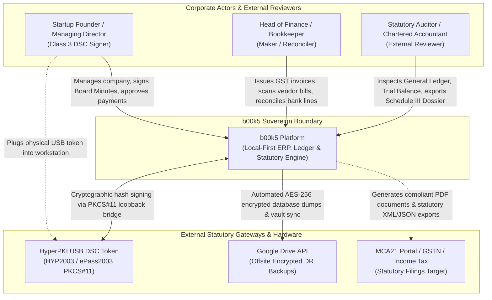
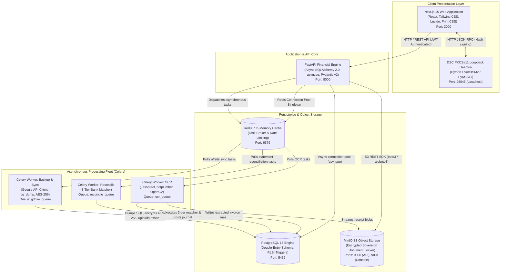
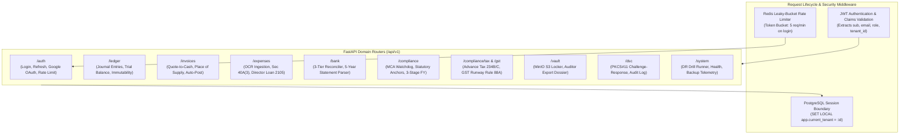
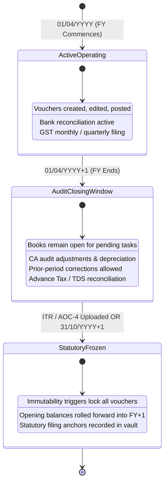
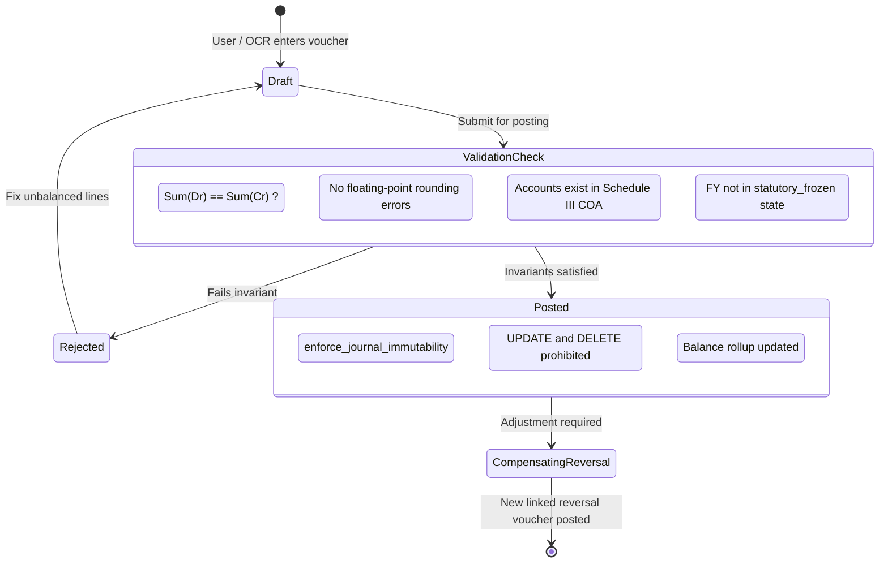
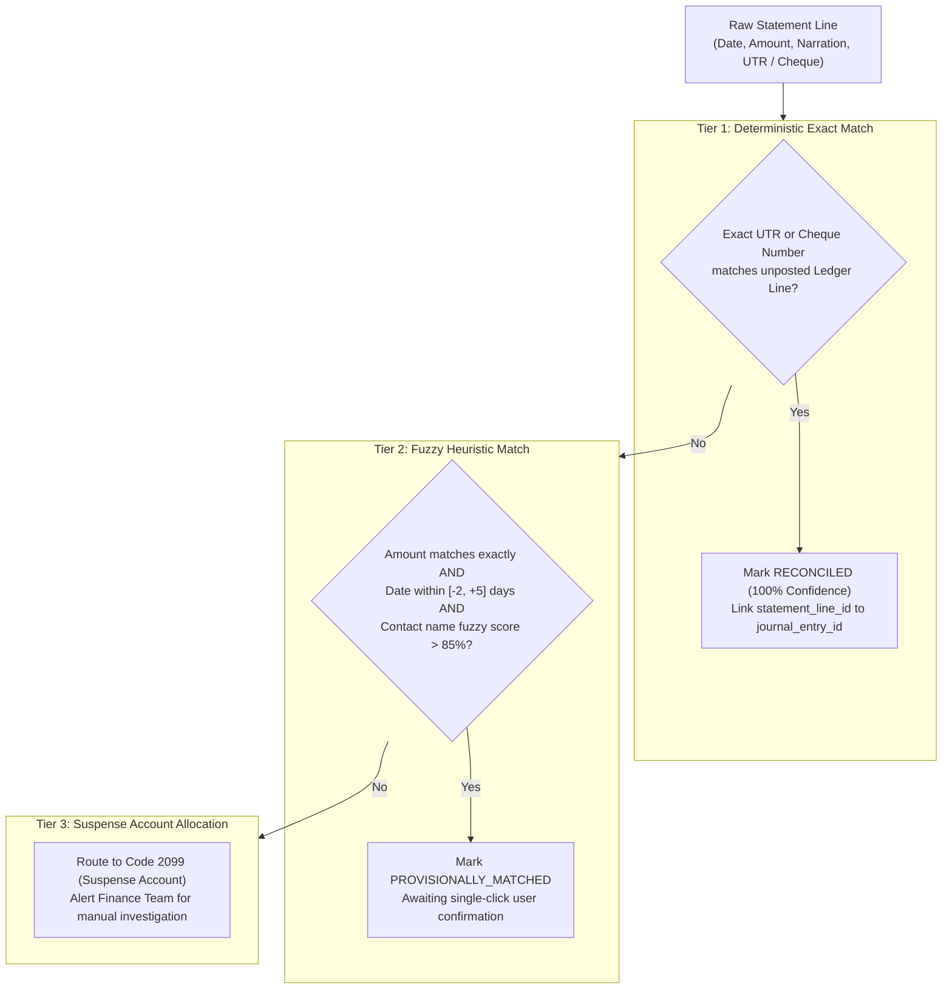
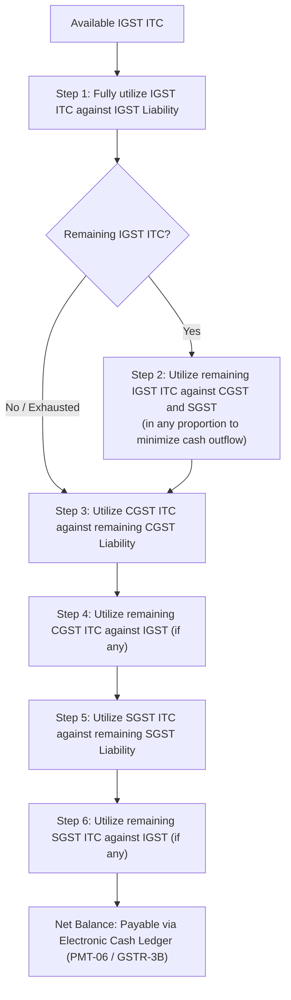

# b00k5 System Architecture & Engineering Blueprint

## 1. Executive Architecture Summary

**b00k5** is an open-source, local-first, multi-tenant financial operating system, general ledger, statutory compliance engine, and legal document vault designed specifically for Indian corporate entities (Private Limited, One Person Companies, and LLPs) operating under the **Companies Act, 2013**, **Central Goods and Services Tax (CGST) Act, 2017**, and the **Income-tax Act, 1961**.

The architecture adheres to five foundational engineering imperatives:
1. **Mathematical Inviolability:** General Ledger double-entry invariant $\left\vert{}\sum \text{Debits} - \sum \text{Credits}\right\vert{} \equiv 0.00$ enforced at the database transaction level via PostgreSQL kernel triggers. Binary floating-point arithmetic is strictly prohibited; all currency arithmetic is executed using arbitrary-precision decimals (`Decimal(15, 2)`) with Banker's Rounding (`ROUND_HALF_EVEN`).
2. **Tenant Isolation via Kernel-Level Row-Level Security (RLS):** Complete multi-tenant partitioning in PostgreSQL where every table enforces `tenant_id` scoping via session-bound parameters (`app.current_tenant = :tenant_id` and `app.current_user_role = :role`) with `FORCE ROW LEVEL SECURITY`.
3. **Statutory 8-Year Document Retention (Sec 128):** All vouchers, invoices, bank statements, and statutory anchors are protected under Companies Act Section 128. Active tenant deletion is blocked via `ON DELETE RESTRICT` foreign keys and soft archiving (`is_archived = TRUE`).
4. **Hardware-Anchored Secretarial Cryptography:** Class-3 Digital Signature Certificate (DSC) signing performed on the client director's workstation via a localhost PKCS#11 loopback bridge (`http://127.0.0.1:28045`), ensuring private cryptographic keys never leave physical smart card silicon.
5. **Authentic Source of Truth & Baseline Calibration:** Prior year opening balances are calibrated directly from authentic filed statutory returns (**MGT-7/7A**, **AOC-4**, **ITR-6/ITR-V**). Authentic binary files are permanently preserved in sovereign MinIO object storage with SHA-256 deduplication.

---

## 2. C4 Architecture Specification

### 2.1 C4 Level 1: System Context Diagram

The System Context diagram details how human actors and external statutory systems interact with the b00k5 platform boundaries.



---

### 2.2 C4 Level 2: Container Diagram

The Container diagram illustrates the runtime microservices, data stores, worker queues, and reverse-proxy components.



---

### 2.3 C4 Level 3: Component Architecture (FastAPI Core)

Inside the FastAPI Core container, endpoints are structured into modular domain routers, governed by strict middleware and dependency injection:



---

## 3. Statutory & Financial State Machines

### 3.1 Three-Stage Fiscal Year Closing Lifecycle

To accommodate Indian statutory audit cycles, the financial year does not abruptly freeze on March 31. Instead, it follows a 3-stage lifecycle:



* **Stage 1: Active Operating Period (`active_operating`):** Runs from 01/04/YYYY to 31/03/YYYY+1. Full operational posting, invoicing, and real-time bank reconciliation.
* **Stage 2: Year-End Audit & Filing Window (`audit_closing_window`):** Runs from 01/04/YYYY+1 until statutory ITR / AOC-4 filing (or statutory deadline 31/10/YYYY+1). The prior FY remains open to allow the founder and statutory CA to post audit adjustments, finalize depreciation under Schedule II, reconcile Form 26AS/AIS, and prepare financial statements.
* **Stage 3: Statutory Freeze (`statutory_frozen`):** Triggered automatically upon uploading filed ITR-6 or AOC-4 (or manual freeze after 31/10). The prior FY is permanently write-protected. Opening balances are calibrated into `statutory_filing_anchors` and become the immutable baseline for the subsequent year.

---

### 3.2 Double-Entry General Ledger Voucher Lifecycle



---

### 3.3 3-Tier Bank Reconciliation Engine

Bank statements (PDF / CSV) are parsed and matched against General Ledger records using a 3-tier cascade:



---

### 3.4 GST Input Tax Credit (ITC) Netting Order (Rule 88A)

GST liabilities are settled strictly according to the statutory hierarchy specified in Rule 88A of the CGST Rules:



---

## 4. Multi-Tenant Security & Isolation Model

### 4.1 PostgreSQL Row-Level Security (RLS) Mechanics

b00k5 relies on PostgreSQL 16's native kernel-level RLS rather than error-prone application-level WHERE filtering.

```sql
-- 1. Enable RLS on operational table
ALTER TABLE journal_entries ENABLE ROW LEVEL SECURITY;
ALTER TABLE journal_entries FORCE ROW LEVEL SECURITY;

-- 2. Define Tenant Scoping Policy
CREATE POLICY tenant_isolation_journal_entries ON journal_entries
    FOR ALL
    USING (tenant_id = NULLIF(current_setting('app.current_tenant', true), '')::UUID)
    WITH CHECK (tenant_id = NULLIF(current_setting('app.current_tenant', true), '')::UUID);
```

On every incoming HTTP request:
1. The `AuthMiddleware` verifies the cryptographic JWT signature and extracts the `tenant_id` claim.
2. In the SQLAlchemy session lifecycle, before any query executes, the session executes:
   ```sql
   SET LOCAL app.current_tenant = :tenant_id;
   SET LOCAL app.current_user_role = :role;
   ```
3. PostgreSQL automatically evaluates the RLS policy. If a query attempts to read, write, or delete rows belonging to another `tenant_id`, PostgreSQL silently filters or raises an RLS check violation.

### 4.2 Companies Act Section 128 Integrity Safeguards

Under Section 128(5) of the Companies Act, 2013, every company must preserve books of account and related vouchers for a minimum of 8 financial years.
To enforce this:
* Foreign keys linking operational records (`journal_entries`, `invoices`, `expenses`, `document_vault`, `statutory_filing_anchors`) to `tenants` are defined as `ON DELETE RESTRICT`.
* Accidental deletion of a tenant is impossible while financial records exist.
* Tenant deactivation is executed via soft archiving (`is_archived = TRUE`, `archived_at = NOW()`).

---

## 5. High-Availability, Performance & Disaster Recovery

### 5.1 Connection Pooling & Resource Isolation

* **PostgreSQL Pool:** Managed by `asyncpg` via SQLAlchemy 2.0 with a pool size of 20 connections and a max overflow of 10. `SET LOCAL` commands are strictly session-scoped and cleared upon connection return to the pool.
* **Redis Pool Singleton:** Centralized thread-safe `redis.ConnectionPool` singleton (`max_connections=20`), preventing socket churn and exhaustion during high-concurrency burst traffic.
* **MinIO S3 Client:** Utilizes persistent keep-alive HTTP connection pools for high-throughput binary document streaming.

### 5.2 Automated Disaster Recovery (DR) Drill

b00k5 includes an automated disaster recovery verification engine (`scripts/dr_drill.py`) executing 6 rigorous gates:
1. **Source State Health:** Validates production database accessibility and baseline ledger balance.
2. **Encrypted Backup Generation:** Generates a full database dump encrypted with AES-256-GCM.
3. **Sandbox Recovery Environment:** Provisions an isolated staging database container.
4. **Decryption & Schema Restoration:** Decrypts the backup payload and restores schema and data.
5. **Ledger Integrity & Zero-Drift Audit:** Recalculates $\sum \text{Debits}$ and $\sum \text{Credits}$ across the restored database, asserting exact mathematical parity ($\Delta = ₹0.00$).
6. **RTO SLA Verification:** Asserts that the entire disaster recovery cycle finishes well within the Recovery Time Objective SLA ($< 30\text{ seconds}$).
