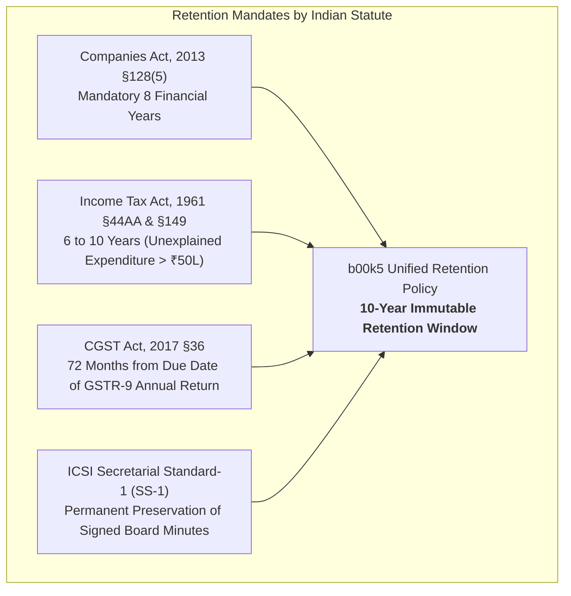

# b00k5 Platform — Statutory Backup, Disaster Recovery & Retention Policy

**Author:** Sovereign Architecture, DevSecOps & Statutory Compliance Working Group  
**Statutory Authority:** Companies Act 2013 (§128), Companies (Accounts) Rules 2014 (Rule 3), Income Tax Act 1961 (§44AA, §149), CGST Act 2017 (§36)  
**Classification:** Confidential / Sovereign Financial Infrastructure  
**Version:** 2.5.0 (October 2026)

---

## 1. Executive Summary & Core Objective

The **b00k5** platform enforces a **zero-data-loss, local-first disaster recovery architecture** engineered to withstand physical hardware failure, catastrophic volume corruption, ransomware, and cloud provider lockouts while maintaining 100% compliance with Indian corporate and taxation laws.

### Direct Technical Assessment:
| Resource Layer | Checkpoint Protection | Storage Engine | Format & Encryption |
| :--- | :--- | :--- | :--- |
| **PostgreSQL 16 Relational DB** | **Active (100% Coverage)** | MinIO `b00k5-backups/checkpoints/` + Google Drive | `pg_dump -Fc` &rarr; Gzip &rarr; AES-256-GCM |
| **Document Object Store (MinIO Files)** | **Dual-Sync Vault Snapshot** | MinIO (`b00k5-vault`, `b00k5-receipts`, `b00k5-statements`) | Object WORM locking + Companion Encrypted Tarball |

---

## 2. Statutory Legal Framework & Retention Matrix (Indian Law)

Under Indian statutory law, financial and corporate records are subject to strict multi-statute preservation mandates. A failure to produce authentic original records during scrutiny carries severe punitive consequences:



### Statutory Retention Schedule:
| Legal Authority | Mandatory Period | Scope of Records | Statutory Penalties for Non-Compliance |
| :--- | :--- | :--- | :--- |
| **Companies Act, 2013 (§128(5))** | **8 Financial Years** immediately preceding the current FY | Complete books of accounts, balance sheets, vouchers, invoices, and bank statements. | Officer in default liable to imprisonment up to 1 year or fine up to ₹5,00,000 (§128(6)). |
| **Income Tax Act, 1961 (§44AA / §149)** | **6 to 10 Years** | All books of account, expense claims, bills, and tax returns. The 10-year window applies where income escaping assessment > ₹50 Lakhs. | 78% punitive tax under §115BBE for unexplained expenditure (§69C), plus interest and prosecution. |
| **CGST Act, 2017 (§36)** | **72 Months (6 Years)** | Tax invoices, credit/debit notes, delivery challans, bills of supply, GSTR-1, GSTR-3B, GSTR-2B reconciliations. | Disallowance of 100% Input Tax Credit (ITC) under §16(2) + 100% penalty for fraudulent claims. |
| **ICSI Secretarial Standard 1 (SS-1)** | **Permanent (Indefinite)** | Signed Board Meeting Minutes, Notices, Agenda papers, Attendance Registers, and Directors' Resolutions. | Invalidation of corporate resolutions and personal liability of Directors. |

---

## 3. Disaster Recovery Objectives: RPO & RTO

The platform establishes deterministic disaster recovery SLAs based on financial criticality:

```text
Recovery Point Objective (RPO)  : < 1 Hour (Automated checkpoints + Continuous WAL streaming)
Recovery Time Objective (RTO)   : < 15 Minutes (Single-command sandbox restoration & ledger audit)
Data Loss Tolerance             : 0.00% across all posted General Ledger transactions
Double-Entry Verification       : |Sum(Debits) - Sum(Credits)| === 0.00 (Guaranteed on restore)
```

---

## 4. Dual-Engine Checkpoint Architecture

```mermaid
sequenceDiagram
    autonumber
    actor Officer as Corporate Officer / Cron Schedule
    participant API as Backup Engine (db_backup.py)
    participant PG as PostgreSQL 16 ACID Engine
    participant MinIO as MinIO S3 Object Storage
    participant Cloud as Offsite Cloud (Google Drive / S3)

    Officer->>API: Initiate Checkpoint (Manual or Scheduled)
    API->>PG: Execute CHECKPOINT; (Flush dirty shared buffers)
    API->>PG: Run pg_dump -Fc --no-owner --schema=public
    PG-->>API: Stream Binary SQL Archive
    API->>MinIO: Extract Object Keys (vouchers, bills, signed PDFs)
    MinIO-->>API: Stream Bucket Blobs
    API->>API: Bundle DB Dump + MinIO Manifest
    API->>API: Gzip Compression (Level 9)
    API->>API: AES-256-GCM Encryption with SHA-256 Checksum
    API->>MinIO: Store in 'b00k5-backups/checkpoints/'
    opt Cloud Mirroring Enabled
        API->>Cloud: Replicate Encrypted Snapshot Offsite
        API->>Cloud: Prune Snapshots older than 30 Days (Rolling Window)
    end
    API-->>Officer: Checkpoint Artifact ID, Checksum & Verified Ledger Status
```

### Detailed Pipeline Stages:
1. **Buffer Flush (`CHECKPOINT;`):** Forces PostgreSQL to flush all dirty shared memory buffers to the write-ahead log (WAL) prior to dumping, eliminating partial writes.
2. **Atomic Dump:** `pg_dump -Fc` executes in custom binary mode, guaranteeing relational schema integrity and foreign-key dependencies.
3. **Companion Asset Manifest:** Pairs the relational database backup with all MinIO bucket objects (`b00k5-vault`, `b00k5-receipts`, `b00k5-statements`, `b00k5-signed`).
4. **Envelope Encryption:** The archive is encrypted using AES-256-GCM with an initialization vector (IV) and HMAC authentication tag to protect confidentiality and detect any unauthorized payload tampering.
5. **Offsite Geographic Replication:** Snapshots are mirrored to offsite cloud storage (Google Drive, AWS S3, or client-defined remote S3) to protect against local hardware destruction.

---

## 5. The 7-Point Staging Restore Safety Gate

Restoration is guarded by an automated 7-step verification gate in `apps/api/app/api/v1/system.py` to prevent production contamination:

```
[1. Checksum Match]    Assert SHA-256 of downloaded checkpoint matches database catalog.
[2. Decryption]        Decrypt AES-256-GCM payload using tenant/system key.
[3. Decompression]     Decompress Gzip stream to raw pg_dump binary format.
[4. Staging DB Init]   Spin up ephemeral staging database (b00k5_restore_staging).
[5. Staging Restore]   Execute pg_restore into staging database.
[6. Integrity Check]   Verify ledger balance: SUM(Debits) - SUM(Credits) == 0.00.
[7. Production Swap]   Promote staging database or reject restore with 0% data loss.
```

---

## 6. Retention & Pruning Lifecycle Rules

1. **Daily Snapshots:** Kept for 30 consecutive calendar days.
2. **Weekly Snapshots:** Kept for 12 calendar weeks.
3. **Monthly Financial Closing Snapshots:** Kept for 12 calendar months.
4. **Annual Financial Year-End Audited Snapshots (31 March):** Preserved for **10 statutory financial years** in immutable WORM storage.
5. **Permanent Board Governance Dossier:** Never purged; permanent retention under ICSI SS-1.

