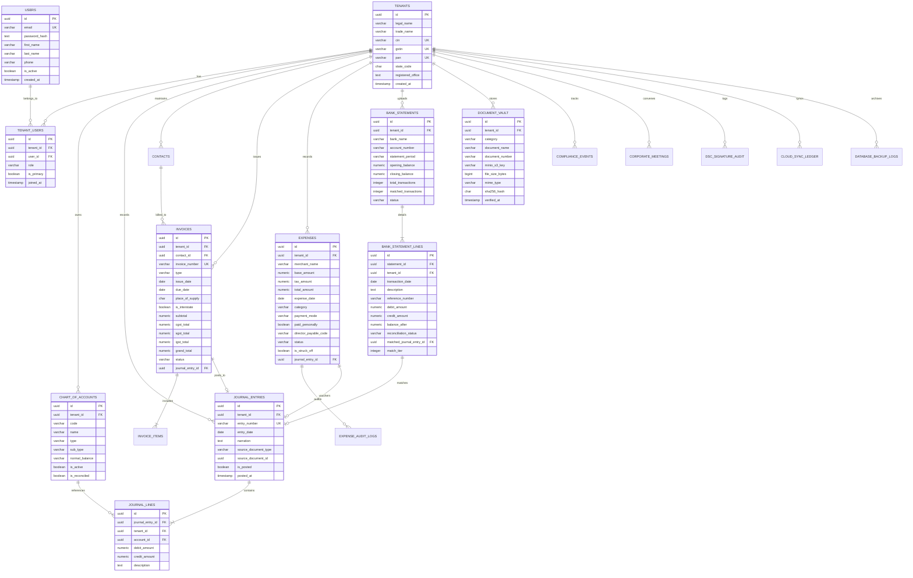

# b00k5 Relational Database Schema & Data Dictionary

## 1. Overview & Architectural Principles

The **b00k5** persistence tier is engineered exclusively on **PostgreSQL 16+**, applying strict double-entry ledger invariants, row-level security (RLS), and immutability controls at the database kernel level.

### Key Data Invariant Standards:
1. **Primary Keys:** Every table uses canonical Version 4 Universally Unique Identifiers (`UUID`) generated via `uuid_generate_v4()`.
2. **Monetary Precision:** Floats (`FLOAT`, `DOUBLE PRECISION`) are prohibited. All monetary and currency values use `NUMERIC(15, 2)` or `NUMERIC(12, 2)` to eliminate IEEE 754 binary floating-point drift.
3. **Transaction Immutability:** Posted general ledger vouchers (`is_posted = TRUE`) reject `UPDATE` and `DELETE` queries via PostgreSQL triggers (`enforce_journal_immutability`). Adjustments must be recorded via compensating reversal entries or credit/debit notes.
4. **Multi-Tenant Row-Level Security:** Every multi-tenant table enforces `FORCE ROW LEVEL SECURITY` linked to `current_setting('app.current_tenant_id', true)::UUID`.

---

## 2. Complete Entity-Relationship Diagram (ERD)



---

## 3. Data Dictionary & Table Specifications

### 3.1 Organization & Identity

#### `tenants`
Stores corporate entities registered under MCA (Private Limited, OPC, LLP).
* `id` (`UUID`, PK, `uuid_generate_v4()`): Unique tenant ID.
* `legal_name` (`VARCHAR(255)`, NOT NULL): Official name as per Certificate of Incorporation (COI).
* `trade_name` (`VARCHAR(255)`): Brand / DBA name.
* `cin` (`VARCHAR(21)`, UNIQUE): 21-digit Corporate Identity Number (e.g., `U72900KA2026PTC123456`).
* `gstin` (`VARCHAR(15)`, UNIQUE): 15-character Goods and Services Tax Identification Number.
* `pan` (`VARCHAR(10)`, UNIQUE): 10-character Permanent Account Number.
* `state_code` (`CHAR(2)`, NOT NULL): 2-digit Indian State Code as per GSTN (e.g., `29` for Karnataka, `27` for Maharashtra).
* `registered_office` (`TEXT`, NOT NULL): Registered address as per MCA Master Data.
* `financial_year_start` (`DATE`, DEFAULT `'2025-04-01'`): Start date of the current accounting period.
* `created_at` (`TIMESTAMPTZ`, DEFAULT `CURRENT_TIMESTAMP`).

#### `users`
Global platform accounts capable of membership across multiple tenants.
* `id` (`UUID`, PK, `uuid_generate_v4()`).
* `email` (`VARCHAR(255)`, UNIQUE, NOT NULL): Primary login email.
* `password_hash` (`TEXT`, NOT NULL): Bcrypt password hash.
* `first_name` (`VARCHAR(128)`, NOT NULL).
* `last_name` (`VARCHAR(128)`, NOT NULL).
* `phone` (`VARCHAR(20)`).
* `is_active` (`BOOLEAN`, DEFAULT `TRUE`).

#### `tenant_users`
Maps users to specific corporate tenants with Role-Based Access Control (RBAC).
* `id` (`UUID`, PK).
* `tenant_id` (`UUID`, FK `tenants.id` ON DELETE CASCADE).
* `user_id` (`UUID`, FK `users.id` ON DELETE CASCADE).
* `role` (`VARCHAR(64)`, NOT NULL): One of `owner`, `admin`, `accountant`, `auditor_ca`, `viewer`.
* `din` (`VARCHAR(8)`): Director Identification Number for signers.
* `is_primary` (`BOOLEAN`, DEFAULT `FALSE`).
* Unique constraint: `(tenant_id, user_id)`.

---

### 3.2 General Ledger & Chart of Accounts

#### `chart_of_accounts`
Standard Schedule III / GAAP accounts master.
* `id` (`UUID`, PK).
* `tenant_id` (`UUID`, FK `tenants.id`).
* `code` (`VARCHAR(32)`, NOT NULL): Numerical account code (e.g., `1010`, `2050`).
* `name` (`VARCHAR(255)`, NOT NULL): Descriptive ledger name.
* `type` (`VARCHAR(32)`, NOT NULL): `asset`, `liability`, `equity`, `revenue`, `expense`.
* `sub_type` (`VARCHAR(64)`, NOT NULL): E.g., `bank`, `current_asset`, `tax_liability`, `payroll`.
* `normal_balance` (`VARCHAR(8)`, NOT NULL): Either `debit` or `credit`.
* `is_active` (`BOOLEAN`, DEFAULT `TRUE`).
* Unique constraint: `(tenant_id, code)`.

#### `journal_entries`
Immutable double-entry transaction headers.
* `id` (`UUID`, PK).
* `tenant_id` (`UUID`, FK `tenants.id`).
* `entry_number` (`VARCHAR(64)`, NOT NULL): Sequence voucher number (e.g., `JV-EXP-4DD0057B`, `INV-2026-001`).
* `entry_date` (`DATE`, NOT NULL): Effective accounting date.
* `narration` (`TEXT`, NOT NULL): Business justification / explanation.
* `source_document_type` (`VARCHAR(64)`): E.g., `invoice`, `expense`, `bank_reconciliation`, `period_close`.
* `source_document_id` (`UUID`): Link to parent invoice/expense/bank line.
* `is_posted` (`BOOLEAN`, DEFAULT `FALSE`): When `TRUE`, record becomes permanently immutable.
* `posted_at` (`TIMESTAMPTZ`): Timestamp of formal ledger entry.

#### `journal_lines`
Individual debit and credit legs of a journal entry.
* `id` (`UUID`, PK).
* `journal_entry_id` (`UUID`, FK `journal_entries.id` ON DELETE RESTRICT).
* `tenant_id` (`UUID`, FK `tenants.id`).
* `account_id` (`UUID`, FK `chart_of_accounts.id`).
* `debit_amount` (`NUMERIC(15, 2)`, NOT NULL, DEFAULT `0.00`, CHECK `>= 0.00`).
* `credit_amount` (`NUMERIC(15, 2)`, NOT NULL, DEFAULT `0.00`, CHECK `>= 0.00`).
* `description` (`TEXT`): Line-specific breakdown.
* Constraint `check_debit_or_credit_positive`: Ensures a line item is either a debit OR a credit, never both and never both zero.

#### `journal_items` (View)
Unified view aggregating `journal_lines` with `chart_of_accounts` details for rapid reporting:
```sql
CREATE VIEW journal_items AS
SELECT 
    jl.id,
    jl.journal_entry_id,
    jl.tenant_id,
    jl.account_id,
    coa.code AS account_code,
    coa.name AS account_name,
    coa.type AS account_type,
    jl.debit_amount,
    jl.credit_amount,
    jl.description,
    je.entry_date,
    je.entry_number,
    je.narration
FROM journal_lines jl
JOIN journal_entries je ON jl.journal_entry_id = je.id
JOIN chart_of_accounts coa ON jl.account_id = coa.id;
```

---

### 3.3 Accounts Receivable & Invoicing

#### `contacts`
Customer and vendor address book with GSTIN profiles.
* `id` (`UUID`, PK).
* `tenant_id` (`UUID`, FK `tenants.id`).
* `name` (`VARCHAR(255)`, NOT NULL).
* `is_customer` (`BOOLEAN`, DEFAULT `FALSE`).
* `is_vendor` (`BOOLEAN`, DEFAULT `FALSE`).
* `gstin` (`VARCHAR(15)`): Counterparty GSTIN.
* `pan` (`VARCHAR(10)`): Permanent Account Number.
* `state_code` (`CHAR(2)`): 2-digit State Code for Place of Supply.
* `billing_address` (`TEXT`).

#### `invoices`
Tax Invoices, Proformas, and Credit Notes.
* `id` (`UUID`, PK).
* `tenant_id` (`UUID`, FK `tenants.id`).
* `contact_id` (`UUID`, FK `contacts.id`).
* `invoice_number` (`VARCHAR(64)`, NOT NULL).
* `type` (`VARCHAR(32)`, DEFAULT `'tax_invoice'`): `tax_invoice`, `proforma`, `credit_note`, `debit_note`.
* `issue_date` (`DATE`, NOT NULL).
* `due_date` (`DATE`, NOT NULL).
* `place_of_supply` (`CHAR(2)`, NOT NULL): Destination state code.
* `is_interstate` (`BOOLEAN`, NOT NULL): Automatically evaluated by database trigger: `is_interstate = (place_of_supply != tenant.state_code)`.
* `subtotal` (`NUMERIC(15, 2)`, NOT NULL).
* `cgst_total` (`NUMERIC(15, 2)`, DEFAULT `0.00`).
* `sgst_total` (`NUMERIC(15, 2)`, DEFAULT `0.00`).
* `igst_total` (`NUMERIC(15, 2)`, DEFAULT `0.00`).
* `grand_total` (`NUMERIC(15, 2)`, NOT NULL).
* `status` (`VARCHAR(32)`, DEFAULT `'draft'`): `draft`, `sent`, `partially_paid`, `paid`, `cancelled`.
* `journal_entry_id` (`UUID`, FK `journal_entries.id`).

#### `invoice_items`
Line items with HSN/SAC classifications.
* `id` (`UUID`, PK).
* `invoice_id` (`UUID`, FK `invoices.id` ON DELETE CASCADE).
* `description` (`TEXT`, NOT NULL).
* `hsn_sac_code` (`VARCHAR(16)`, NOT NULL): HSN for goods, SAC for services.
* `quantity` (`NUMERIC(12, 4)`, NOT NULL, DEFAULT `1.0000`).
* `unit_price` (`NUMERIC(15, 2)`, NOT NULL).
* `tax_rate_percent` (`NUMERIC(5, 2)`, NOT NULL): E.g., `18.00`, `12.00`, `5.00`.
* `taxable_amount` (`NUMERIC(15, 2)`, NOT NULL).
* `cgst_amount` (`NUMERIC(15, 2)`, DEFAULT `0.00`).
* `sgst_amount` (`NUMERIC(15, 2)`, DEFAULT `0.00`).
* `igst_amount` (`NUMERIC(15, 2)`, DEFAULT `0.00`).
* `total_amount` (`NUMERIC(15, 2)`, NOT NULL).

---

### 3.4 Accounts Payable, Expenses & Reimbursements

#### `expenses`
Vendor bills and founder out-of-pocket claims.
* `id` (`UUID`, PK).
* `tenant_id` (`UUID`, FK `tenants.id`).
* `merchant_name` (`VARCHAR(255)`, NOT NULL).
* `merchant_gstin` (`VARCHAR(15)`): Extracted via OCR regex.
* `expense_date` (`DATE`, NOT NULL).
* `category` (`VARCHAR(64)`, NOT NULL): E.g., `cloud_hosting`, `professional_legal`, `office_rent`.
* `category_code` (`VARCHAR(16)`): Standard COA reference (e.g., `4010`).
* `base_amount` (`NUMERIC(15, 2)`, NOT NULL).
* `tax_amount` (`NUMERIC(15, 2)`, DEFAULT `0.00`).
* `total_amount` (`NUMERIC(15, 2)`, NOT NULL).
* `payment_mode` (`VARCHAR(32)`): `bank_transfer`, `credit_card`, `cash`, `upi`.
* `paid_personally` (`BOOLEAN`, DEFAULT `FALSE`): When `TRUE`, triggers Director Reimbursements liability.
* `director_payable_code` (`VARCHAR(32)`, DEFAULT `'2105'`).
* `tds_section` (`VARCHAR(16)`): E.g., `194C`, `194J`, `194I`.
* `tds_rate_percent` (`NUMERIC(5, 2)`, DEFAULT `0.00`).
* `tds_deducted_amount` (`NUMERIC(15, 2)`, DEFAULT `0.00`).
* `status` (`VARCHAR(32)`, DEFAULT `'pending'`): `pending`, `approved`, `reimbursed`, `rejected`.
* `is_struck_off` (`BOOLEAN`, DEFAULT `FALSE`): Audit trail strike-off flag.
* `strike_off_reason` (`TEXT`): Auditor rationale when item is voided.
* `journal_entry_id` (`UUID`, FK `journal_entries.id`).
* `minio_receipt_key` (`VARCHAR(512)`): Path in S3 `b00k5-receipts` bucket.

#### `expense_audit_logs`
Chronological event ledger recording every edit, strike-off, and status transition.
* `id` (`UUID`, PK).
* `expense_id` (`UUID`, FK `expenses.id` ON DELETE CASCADE).
* `changed_by` (`UUID`, FK `users.id`).
* `action` (`VARCHAR(64)`, NOT NULL): `created`, `updated`, `struck_off`, `reimbursed`.
* `previous_state` (`JSONB`).
* `new_state` (`JSONB`).
* `change_reason` (`TEXT`).
* `created_at` (`TIMESTAMPTZ`, DEFAULT `CURRENT_TIMESTAMP`).

---

### 3.5 Bank Reconciliation

#### `bank_statements`
Ingested monthly statement batches.
* `id` (`UUID`, PK).
* `tenant_id` (`UUID`, FK `tenants.id`).
* `bank_name` (`VARCHAR(128)`, NOT NULL): E.g., `HDFC Bank`, `ICICI Bank`.
* `account_number` (`VARCHAR(64)`, NOT NULL).
* `statement_period` (`VARCHAR(32)`, NOT NULL): E.g., `2025-05`, `2025-06`.
* `opening_balance` (`NUMERIC(15, 2)`, NOT NULL).
* `closing_balance` (`NUMERIC(15, 2)`, NOT NULL).
* `total_transactions` (`INTEGER`, DEFAULT `0`).
* `matched_transactions` (`INTEGER`, DEFAULT `0`).
* `status` (`VARCHAR(32)`, DEFAULT `'pending'`): `pending`, `reconciled`, `discrepant`.

#### `bank_statement_lines`
Individual lines extracted from bank statements.
* `id` (`UUID`, PK).
* `statement_id` (`UUID`, FK `bank_statements.id` ON DELETE CASCADE).
* `tenant_id` (`UUID`, FK `tenants.id`).
* `transaction_date` (`DATE`, NOT NULL).
* `description` (`TEXT`, NOT NULL): Raw narration string.
* `reference_number` (`VARCHAR(128)`): Extracted UTR, IMPS, or Cheque number.
* `debit_amount` (`NUMERIC(15, 2)`, DEFAULT `0.00`).
* `credit_amount` (`NUMERIC(15, 2)`, DEFAULT `0.00`).
* `balance_after` (`NUMERIC(15, 2)`, NOT NULL).
* `reconciliation_status` (`VARCHAR(32)`, DEFAULT `'unmatched'`): `unmatched`, `matched`, `suspense`.
* `matched_journal_entry_id` (`UUID`, FK `journal_entries.id`).
* `match_tier` (`INTEGER`): `1` (Exact UTR), `2` (Fuzzy date/amount), `3` (Suspense allocation).

---

### 3.6 Statutory Vault & Compliance

#### `document_vault`
Central cryptographic legal repository.
* `id` (`UUID`, PK).
* `tenant_id` (`UUID`, FK `tenants.id`).
* `category` (`VARCHAR(64)`, NOT NULL): `corporate_legal`, `tax_registrations`, `operational_licenses`, `equity_captable`, `statutory_filings`.
* `document_name` (`VARCHAR(255)`, NOT NULL).
* `document_number` (`VARCHAR(128)`): E.g., PAN, GSTIN, CIN, Resolution number.
* `minio_s3_key` (`VARCHAR(512)`, NOT NULL): S3 object location.
* `file_size_bytes` (`BIGINT`, NOT NULL).
* `mime_type` (`VARCHAR(128)`, NOT NULL).
* `sha256_hash` (`CHAR(64)`, NOT NULL): Cryptographic fingerprint for tamper-evidence.
* `verified_at` (`TIMESTAMPTZ`): Timestamp when audited by CA.

#### `compliance_events`
Statutory compliance calendar tracking deadlines and fines.
* `id` (`UUID`, PK).
* `tenant_id` (`UUID`, FK `tenants.id`).
* `title` (`VARCHAR(255)`, NOT NULL).
* `statutory_ref` (`VARCHAR(128)`, NOT NULL): E.g., `Companies Act Sec 173`, `MCA Form INC-20A`.
* `due_date` (`DATE`, NOT NULL).
* `fine_per_day` (`NUMERIC(10, 2)`, DEFAULT `100.00`).
* `status` (`VARCHAR(32)`, DEFAULT `'upcoming'`): `upcoming`, `due_soon`, `overdue`, `filed`, `verified`, `compliant`.
* `completion_date` (`DATE`): Recorded filing date.
* `mca_srn` (`VARCHAR(32)`): Service Request Number from MCA21 portal.

#### `dsc_signature_audit`
Cryptographic log of hardware DSC token signatures.
* `id` (`UUID`, PK).
* `tenant_id` (`UUID`, FK `tenants.id`).
* `document_id` (`UUID`, FK `document_vault.id`).
* `signer_user_id` (`UUID`, FK `users.id`).
* `signer_name` (`VARCHAR(255)`, NOT NULL).
* `signer_din` (`VARCHAR(8)`): Director Identification Number.
* `certificate_issuer` (`VARCHAR(255)`, NOT NULL): E.g., `eMudhra`, `Capricorn`, `VSign`.
* `certificate_serial` (`VARCHAR(128)`, NOT NULL).
* `sha256_hash` (`CHAR(64)`, NOT NULL): Digest of document signed.
* `signature_timestamp` (`TIMESTAMPTZ`, DEFAULT `CURRENT_TIMESTAMP`).

---

## 4. Database Triggers & Business Constraints

### 4.1 Inviolable Zero-Sum Trigger (`check_zero_sum_balance`)
```sql
CREATE OR REPLACE FUNCTION verify_journal_entry_balance()
RETURNS TRIGGER AS $$
DECLARE
    v_total_debit NUMERIC(15, 2);
    v_total_credit NUMERIC(15, 2);
    v_discrepancy NUMERIC(15, 2);
BEGIN
    SELECT 
        COALESCE(SUM(debit_amount), 0.00),
        COALESCE(SUM(credit_amount), 0.00)
    INTO v_total_debit, v_total_credit
    FROM journal_lines
    WHERE journal_entry_id = NEW.journal_entry_id;

    v_discrepancy := ABS(v_total_debit - v_total_credit);

    IF v_discrepancy > 0.00 THEN
        RAISE EXCEPTION 'check_zero_sum_balance: Inviolable Double-Entry Invariant Failed! Total Debits (%) != Total Credits (%). Discrepancy: %',
            v_total_debit, v_total_credit, v_discrepancy;
    END IF;

    RETURN NEW;
END;
$$ LANGUAGE plpgsql;

CREATE CONSTRAINT TRIGGER check_zero_sum_balance
AFTER INSERT OR UPDATE ON journal_lines
DEFERRABLE INITIALLY DEFERRED
FOR EACH ROW
EXECUTE FUNCTION verify_journal_entry_balance();
```

### 4.2 Immutability Trigger (`enforce_journal_immutability`)
```sql
CREATE OR REPLACE FUNCTION protect_posted_journal_entries()
RETURNS TRIGGER AS $$
BEGIN
    IF OLD.is_posted = TRUE THEN
        RAISE EXCEPTION 'Immutability Violation: Posted journal entries (entry_number: %) cannot be modified or deleted.', OLD.entry_number;
    END IF;
    RETURN OLD;
END;
$$ LANGUAGE plpgsql;

CREATE TRIGGER enforce_journal_immutability
BEFORE UPDATE OR DELETE ON journal_entries
FOR EACH ROW
EXECUTE FUNCTION protect_posted_journal_entries();
```

---

## 5. Schedule III Chart of Accounts Code Standards

| Code Range | Class | Normal Balance | Description | Example Accounts |
| :--- | :--- | :--- | :--- | :--- |
| **1000–1099** | Assets (Current & Liquid) | **Debit** | Liquid bank balances, cash, fixed deposits | `1010 Bank (HDFC)`, `1040 Fixed Deposits` |
| **1100–1199** | Assets (Receivables) | **Debit** | Trade Debtors, customer receivables | `1020 Trade Receivables` |
| **1200–1299** | Assets (Tax Credits) | **Debit** | Input Tax Credits (GST) | `1030 Input CGST`, `1031 Input SGST`, `1032 Input IGST` |
| **1500–1599** | Assets (Fixed / PP&E) | **Debit** | Property, Plant & Equipment | `1050 IT Hardware & Workstations` |
| **2000–2099** | Equity & Capital | **Credit** | Issued share capital, retained earnings | `2010 Share Capital`, `2020 Reserves & Surplus` |
| **2100–2199** | Liabilities (Director & Debt)| **Credit** | Director borrowings & personal claims | `2030 Director Loans`, `2105 Founder Reimbursements` |
| **2200–2299** | Liabilities (Payables) | **Credit** | Trade Creditors, vendor payables | `2040 Trade Payables` |
| **2300–2399** | Liabilities (Tax Duties) | **Credit** | Output GST collected & TDS withheld | `2050 Output CGST`, `2060 TDS Payable u/s 194J` |
| **2099** | Suspense / Clearing | **Credit** | Unmatched bank statement reconciliation | `2099 Bank Reconciliation Suspense` |
| **3000–3999** | Revenue (Income) | **Credit** | Operating SaaS sales, consulting services | `3010 SaaS Subscriptions`, `3030 FD Interest` |
| **4000–4999** | Expenses (Direct) | **Debit** | Cloud compute, hosting, server infrastructure| `4010 Cloud Infrastructure (AWS/GCP)` |
| **5000–5999** | Expenses (Indirect & Admin)| **Debit** | Salaries, legal counsel, office rent | `4020 Payroll`, `5010 Legal & Professional Fees` |
