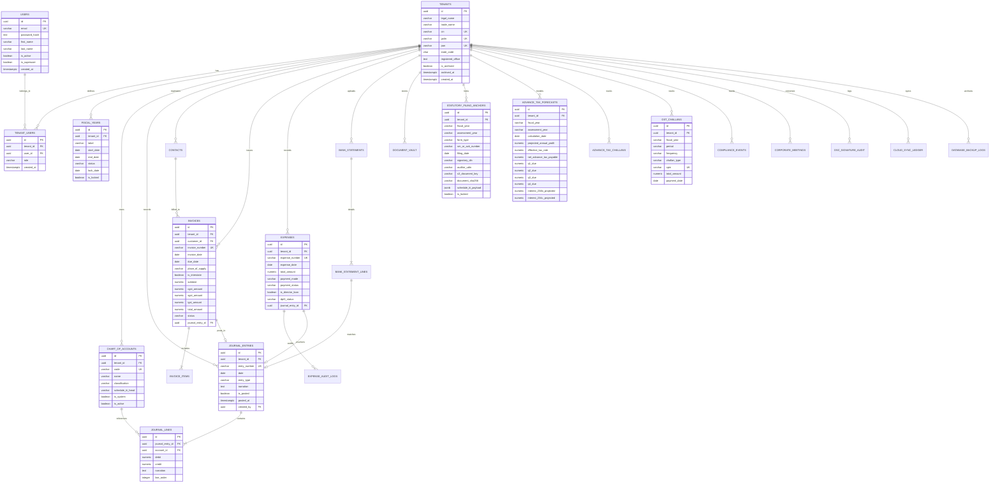

# b00k5 Relational Database Schema & Data Dictionary

## 1. Overview & Architectural Principles

The **b00k5** persistence tier is engineered exclusively on **PostgreSQL 16+**, applying strict double-entry ledger invariants, row-level security (RLS), and immutability controls at the database kernel level.

### Key Data Invariant Standards:
1. **Primary Keys:** Every table uses canonical Version 4 Universally Unique Identifiers (`UUID`) generated via `uuid_generate_v4()`.
2. **Monetary Precision:** Binary floats (`FLOAT`, `DOUBLE PRECISION`) are strictly prohibited. All monetary and currency values use `NUMERIC(15, 2)` to eliminate IEEE 754 binary floating-point drift.
3. **Transaction Immutability:** Posted general ledger vouchers (`is_posted = TRUE`) reject `UPDATE` and `DELETE` queries via PostgreSQL kernel triggers (`enforce_journal_immutability`). Adjustments must be recorded via compensating reversal entries or credit/debit notes.
4. **Multi-Tenant Row-Level Security:** Every multi-tenant table enforces `ENABLE ROW LEVEL SECURITY` and `FORCE ROW LEVEL SECURITY` linked to `current_setting('app.current_tenant', true)::UUID`.
5. **Companies Act Section 128 Retention:** Foreign keys linking operational records (`journal_entries`, `invoices`, `expenses`, `document_vault`, `statutory_filing_anchors`) to `tenants` enforce `ON DELETE RESTRICT`. Tenant deactivation occurs via soft archiving (`is_archived = TRUE`, `archived_at = TIMESTAMPTZ`), safeguarding the statutory 8-year record preservation requirement.

---

## 2. Complete Entity-Relationship Diagram (ERD)



---

## 3. Comprehensive Table Data Dictionary

### 3.1 Organization & Identity

#### `tenants`
Stores registered legal entities (Private Limited, OPC, LLP).
* `id` (`UUID`, PK): Entity unique identifier.
* `legal_name` (`VARCHAR(255)`, NOT NULL): Official legal name registered with MCA.
* `trade_name` (`VARCHAR(255)`): Trade/doing-business-as name.
* `cin` (`VARCHAR(21)`, UNIQUE): 21-character Corporate Identity Number.
* `gstin` (`VARCHAR(15)`, UNIQUE): 15-character Goods and Services Tax Identification Number.
* `pan` (`VARCHAR(10)`, UNIQUE): 10-character Permanent Account Number.
* `state_code` (`CHAR(2)`, NOT NULL): 2-digit Indian State code (e.g., `29` for Karnataka).
* `registered_office` (`TEXT`): Official registered address for statutory notices.
* `is_archived` (`BOOLEAN`, DEFAULT `FALSE`): Companies Act Sec 128 soft-delete flag.
* `archived_at` (`TIMESTAMPTZ`): Timestamp when organization was archived.
* `created_at` (`TIMESTAMPTZ`, DEFAULT `CURRENT_TIMESTAMP`).

#### `users`
Global authentication directory.
* `id` (`UUID`, PK): User unique identifier.
* `email` (`VARCHAR(255)`, UNIQUE, NOT NULL): Authentication email address.
* `password_hash` (`TEXT`, NOT NULL): Argon2id or bcrypt password hash.
* `first_name` (`VARCHAR(100)`), `last_name` (`VARCHAR(100)`).
* `is_active` (`BOOLEAN`, DEFAULT `TRUE`): Login active state.
* `is_superuser` (`BOOLEAN`, DEFAULT `FALSE`): Platform admin privilege.

#### `tenant_users`
Multi-tenant membership and Role-Based Access Control (RBAC).
* `id` (`UUID`, PK).
* `tenant_id` (`UUID`, NOT NULL, FK `tenants.id` ON DELETE RESTRICT).
* `user_id` (`UUID`, NOT NULL, FK `users.id` ON DELETE CASCADE).
* `role` (`VARCHAR(50)`, NOT NULL): Role persona (`owner`, `admin`, `accountant`, `auditor_ca`, `viewer`).

---

### 3.2 General Ledger & Financial Invariants

#### `fiscal_years`
Tracks financial year operating states and 3-stage closing cycles.
* `id` (`UUID`, PK).
* `tenant_id` (`UUID`, NOT NULL, FK `tenants.id`).
* `label` (`VARCHAR(32)`, NOT NULL): Display label (e.g., `FY 2026-27`).
* `start_date` (`DATE`, NOT NULL): April 1 of start year.
* `end_date` (`DATE`, NOT NULL): March 31 of end year.
* `status` (`VARCHAR(32)`, NOT NULL): `active_operating`, `audit_closing_window`, or `statutory_frozen`.
* `lock_date` (`DATE`): Date after which voucher modifications are prohibited.
* `is_locked` (`BOOLEAN`, DEFAULT `FALSE`).

#### `chart_of_accounts`
Schedule III Division I compliant nominal, real, and personal accounts.
* `id` (`UUID`, PK).
* `tenant_id` (`UUID`, NOT NULL, FK `tenants.id`).
* `code` (`VARCHAR(20)`, NOT NULL): Unique numerical account code (e.g., `1001`, `2105`, `4001`).
* `name` (`VARCHAR(255)`, NOT NULL): Account title.
* `classification` (`VARCHAR(50)`, NOT NULL): `ASSET`, `LIABILITY`, `EQUITY`, `REVENUE`, `EXPENSE`.
* `schedule_iii_head` (`VARCHAR(100)`): Schedule III Non-Ind AS line mapping.
* `is_system` (`BOOLEAN`, DEFAULT `FALSE`): Protected platform account.
* `is_active` (`BOOLEAN`, DEFAULT `TRUE`).

#### `journal_entries`
Double-entry voucher headers.
* `id` (`UUID`, PK).
* `tenant_id` (`UUID`, NOT NULL, FK `tenants.id` ON DELETE RESTRICT).
* `entry_number` (`VARCHAR(50)`, NOT NULL): Sequential voucher reference (e.g., `JV-2026-0001`).
* `date` (`DATE`, NOT NULL): Transaction date (`DD/MM/YYYY`).
* `entry_type` (`VARCHAR(50)`, NOT NULL): `STANDARD`, `INVOICE`, `EXPENSE`, `BANK`, `REVERSAL`, `AUDIT_ADJUSTMENT`.
* `narration` (`TEXT`, NOT NULL): Audit rationale.
* `is_posted` (`BOOLEAN`, DEFAULT `FALSE`): When `TRUE`, trigger blocks updates.
* `posted_at` (`TIMESTAMPTZ`): Timestamp of posting.
* `created_by` (`UUID`, FK `users.id`).

#### `journal_lines`
Individual debit and credit postings.
* `id` (`UUID`, PK).
* `journal_entry_id` (`UUID`, NOT NULL, FK `journal_entries.id` ON DELETE CASCADE).
* `account_id` (`UUID`, NOT NULL, FK `chart_of_accounts.id`).
* `debit` (`NUMERIC(15, 2)`, NOT NULL, DEFAULT `0.00`): Debit amount ($\ge 0$).
* `credit` (`NUMERIC(15, 2)`, NOT NULL, DEFAULT `0.00`): Credit amount ($\ge 0$).
* `narration` (`TEXT`): Line-specific annotation.
* `line_order` (`INTEGER`, NOT NULL): Sequence order for voucher rendering.

---

### 3.3 Banking & 3-Tier Reconciliation

#### `bank_statements`
Headers for imported bank statements (PDF / CSV / MT940).
* `id` (`UUID`, PK).
* `tenant_id` (`UUID`, NOT NULL, FK `tenants.id` ON DELETE RESTRICT).
* `bank_name` (`VARCHAR(100)`, NOT NULL): Bank institution name.
* `account_number_mask` (`VARCHAR(20)`): Masked account identifier.
* `period_start` (`DATE`, NOT NULL), `period_end` (`DATE`, NOT NULL).
* `opening_balance` (`NUMERIC(15, 2)`), `closing_balance` (`NUMERIC(15, 2)`).
* `s3_document_key` (`VARCHAR(500)`): MinIO object key for authentic uploaded file.

#### `bank_statement_lines`
Individual bank statement transaction records.
* `id` (`UUID`, PK).
* `statement_id` (`UUID`, NOT NULL, FK `bank_statements.id` ON DELETE CASCADE).
* `transaction_date` (`DATE`, NOT NULL).
* `value_date` (`DATE`).
* `amount` (`NUMERIC(15, 2)`, NOT NULL): Positive for credits, negative for debits.
* `reference_number` (`VARCHAR(100)`): UTR / Cheque / IMPS / NEFT reference.
* `narration` (`TEXT`): Raw bank narrative.
* `status` (`VARCHAR(50)`, DEFAULT `'UNRECONCILED'`): `UNRECONCILED`, `PROVISIONALLY_MATCHED`, `RECONCILED`, `SUSPENSE`.
* `matched_journal_entry_id` (`UUID`, FK `journal_entries.id`).
* `match_confidence` (`NUMERIC(5, 2)`): 1.00 for Tier 1, 0.85+ for Tier 2.

---

### 3.4 Invoicing & Expenses

#### `invoices`
Sales tax invoices complying with Rule 46 of CGST Rules.
* `id` (`UUID`, PK).
* `tenant_id` (`UUID`, NOT NULL, FK `tenants.id` ON DELETE RESTRICT).
* `customer_id` (`UUID`, NOT NULL, FK `contacts.id`).
* `invoice_number` (`VARCHAR(50)`, NOT NULL): Sequential tax invoice series.
* `invoice_date` (`DATE`, NOT NULL), `due_date` (`DATE`, NOT NULL).
* `place_of_supply` (`CHAR(2)`, NOT NULL): 2-digit Indian State code.
* `is_interstate` (`BOOLEAN`, NOT NULL): `TRUE` = IGST, `FALSE` = CGST + SGST.
* `subtotal` (`NUMERIC(15, 2)`, NOT NULL).
* `cgst_amount` (`NUMERIC(15, 2)`, DEFAULT `0.00`).
* `sgst_amount` (`NUMERIC(15, 2)`, DEFAULT `0.00`).
* `igst_amount` (`NUMERIC(15, 2)`, DEFAULT `0.00`).
* `total_amount` (`NUMERIC(15, 2)`, NOT NULL).
* `status` (`VARCHAR(50)`, DEFAULT `'DRAFT'`): `DRAFT`, `ISSUED`, `PAID`, `CANCELLED`.
* `journal_entry_id` (`UUID`, FK `journal_entries.id`): Auto-posted voucher.

#### `expenses`
Vendor bills, founder out-of-pocket claims, and director loans.
* `id` (`UUID`, PK).
* `tenant_id` (`UUID`, NOT NULL, FK `tenants.id` ON DELETE RESTRICT).
* `vendor_id` (`UUID`, FK `contacts.id`).
* `expense_number` (`VARCHAR(50)`, NOT NULL).
* `expense_date` (`DATE`, NOT NULL).
* `total_amount` (`NUMERIC(15, 2)`, NOT NULL).
* `payment_mode` (`VARCHAR(50)`, NOT NULL): `DIRECTOR_PERSONAL`, `COMPANY_BANK`, `PETTY_CASH`.
* `payment_status` (`VARCHAR(50)`, DEFAULT `'UNPAID'`): `UNPAID`, `REIMBURSED`, `SETTLED`.
* `is_director_loan` (`BOOLEAN`, DEFAULT `FALSE`): Rule 2(1)(c)(viii) DPT-3 loan flag.
* `dpt3_status` (`VARCHAR(50)`, DEFAULT `'EXEMPT'`): Statutory loan disclosure status.
* `sec40a3_violation` (`BOOLEAN`, DEFAULT `FALSE`): Income Tax single-day cash $> ₹10,000$ alert.
* `journal_entry_id` (`UUID`, FK `journal_entries.id`).

---

### 3.5 Statutory Filings, Tax Forecasting & SRE Logs

#### `statutory_filing_anchors`
Preserves certified prior-year opening balances from filed returns (**MGT-7/7A**, **AOC-4**, **ITR-6**).
* `id` (`UUID`, PK).
* `tenant_id` (`UUID`, NOT NULL, FK `tenants.id` ON DELETE RESTRICT).
* `fiscal_year` (`VARCHAR(32)`, NOT NULL): e.g., `FY 2025-26`.
* `assessment_year` (`VARCHAR(32)`, NOT NULL): e.g., `AY 2026-27`.
* `form_type` (`VARCHAR(50)`, NOT NULL): `AOC_4`, `MGT_7`, `MGT_7A`, `ITR_6`.
* `srn_or_ack_number` (`VARCHAR(100)`, NOT NULL): MCA SRN or ITR Ack Number.
* `filing_date` (`DATE`, NOT NULL).
* `signatory_din` (`VARCHAR(8)`): Director DIN.
* `auditor_udin` (`VARCHAR(18)`): ICAI Unique Document Identification Number.
* `s3_document_key` (`VARCHAR(500)`): MinIO authentic binary key.
* `document_sha256` (`VARCHAR(64)`): Cryptographic hash.
* `schedule_iii_payload` (`JSONB`, DEFAULT `'{}'`): Extracted opening balances.
* `is_locked` (`BOOLEAN`, DEFAULT `TRUE`).

#### `advance_tax_forecasts`
Income Tax Section 208/209/210 and Section 234B/234C interest projection engine.
* `id` (`UUID`, PK).
* `tenant_id` (`UUID`, NOT NULL, FK `tenants.id` ON DELETE CASCADE).
* `fiscal_year` (`VARCHAR(32)`, NOT NULL), `assessment_year` (`VARCHAR(32)`, NOT NULL).
* `calculation_date` (`DATE`, NOT NULL).
* `tax_regime` (`VARCHAR(50)`, NOT NULL): e.g., `SECTION_115BAA` (22% + 10% surcharge + 4% cess = 25.168%).
* `projected_annual_profit` (`NUMERIC(15, 2)`), `net_advance_tax_payable` (`NUMERIC(15, 2)`).
* `q1_due`, `q2_due`, `q3_due`, `q4_due` (`NUMERIC(15, 2)`): Statutory cumulative installments (15%, 45%, 75%, 100%).
* `q1_paid`, `q2_paid`, `q3_paid`, `q4_paid` (`NUMERIC(15, 2)`): Actual tax challans credited.
* `interest_234c_projected`, `interest_234b_projected` (`NUMERIC(15, 2)`): Penal interest calculations.

#### `gst_challans`
Records PMT-06 and GSTR-3B tax payment challans.
* `id` (`UUID`, PK).
* `tenant_id` (`UUID`, NOT NULL, FK `tenants.id` ON DELETE CASCADE).
* `fiscal_year` (`VARCHAR(32)`, NOT NULL), `period` (`VARCHAR(32)`, NOT NULL).
* `frequency` (`VARCHAR(32)`, NOT NULL): `MONTHLY`, `QUARTERLY`.
* `challan_type` (`VARCHAR(32)`, NOT NULL): `PMT_06`, `GSTR_3B`.
* `cpin` (`VARCHAR(20)`, UNIQUE, NOT NULL): 14-digit Common Portal Identification Number.
* `cin` (`VARCHAR(30)`): Challan Identification Number.
* `payment_date` (`DATE`, NOT NULL).
* `cgst_amount`, `sgst_amount`, `igst_amount`, `cess_amount` (`NUMERIC(15, 2)`).
* `total_amount` (`NUMERIC(15, 2)`, NOT NULL).

#### `database_backup_logs`
SRE disaster recovery verification and automated backup registry.
* `id` (`UUID`, PK).
* `tenant_id` (`UUID`, NOT NULL, FK `tenants.id`).
* `backup_filename` (`VARCHAR(255)`, NOT NULL).
* `backup_type` (`VARCHAR(50)`, NOT NULL): `SCHEDULED_NIGHTLY`, `PRE_UPGRADE`, `DR_DRILL`.
* `file_size_bytes` (`BIGINT`, NOT NULL).
* `checksum_sha256` (`VARCHAR(64)`, NOT NULL).
* `encryption_mode` (`VARCHAR(50)`, DEFAULT `'AES-256-GCM'`).
* `status` (`VARCHAR(50)`, DEFAULT `'SUCCESS'`).

---

## 4. Kernel Triggers & Stored Functions

### 4.1 Transaction Immutability Trigger (`enforce_journal_immutability`)
```sql
CREATE OR REPLACE FUNCTION enforce_journal_immutability()
RETURNS TRIGGER AS $$
BEGIN
    IF OLD.is_posted = TRUE THEN
        RAISE EXCEPTION 'COMPLIANCE VIOLATION: Posted journal entries are strictly immutable. Compensating adjustment entry required.'
            USING ERRCODE = 'P0001';
    END IF;
    RETURN NEW;
END;
$$ LANGUAGE plpgsql;

CREATE TRIGGER trg_journal_entry_immutability
BEFORE UPDATE OR DELETE ON journal_entries
FOR EACH ROW EXECUTE FUNCTION enforce_journal_immutability();
```

### 4.2 Balanced Voucher Invariant Function (`check_journal_balance`)
```sql
CREATE OR REPLACE FUNCTION check_journal_balance(entry_id UUID)
RETURNS BOOLEAN AS $$
DECLARE
    v_total_debit NUMERIC(15, 2);
    v_total_credit NUMERIC(15, 2);
BEGIN
    SELECT COALESCE(SUM(debit), 0.00), COALESCE(SUM(credit), 0.00)
    INTO v_total_debit, v_total_credit
    FROM journal_lines
    WHERE journal_entry_id = entry_id;

    IF v_total_debit <> v_total_credit THEN
        RAISE EXCEPTION 'LEDGER UNBALANCED: Total Debits (%) do not equal Total Credits (%) for voucher %',
            v_total_debit, v_total_credit, entry_id
            USING ERRCODE = 'P0002';
    END IF;

    RETURN TRUE;
END;
$$ LANGUAGE plpgsql;
```

---

## 5. Schedule III Chart of Accounts (Non-Ind AS Division I Seed)

| Account Code | Account Name | Classification | Schedule III Head |
| :--- | :--- | :--- | :--- |
| `1001` | Equity Share Capital | `EQUITY` | Share Capital |
| `1002` | Retained Earnings | `EQUITY` | Reserves and Surplus |
| `2001` | Long-Term Bank Borrowings | `LIABILITY` | Long-Term Borrowings |
| `2002` | Short-Term Working Capital Loans | `LIABILITY` | Short-Term Borrowings |
| `2003` | Trade Payables (Sundry Creditors) | `LIABILITY` | Trade Payables |
| `2099` | Bank Reconciliation Suspense | `LIABILITY` | Other Current Liabilities |
| `2101` | CGST Output Payable | `LIABILITY` | Other Current Liabilities |
| `2102` | SGST Output Payable | `LIABILITY` | Other Current Liabilities |
| `2103` | IGST Output Payable | `LIABILITY` | Other Current Liabilities |
| `2104` | TDS Payable (Section 194C/J/I) | `LIABILITY` | Other Current Liabilities |
| `2105` | Director Reimbursements Payable | `LIABILITY` | Other Current Liabilities (Rule 2(1)(c)(viii)) |
| `3001` | Computer Equipment & Hardware | `ASSET` | Property, Plant & Equipment |
| `3002` | Software Licenses & IP | `ASSET` | Intangible Assets |
| `3003` | Accumulated Depreciation | `ASSET` | Accumulated Depreciation |
| `3101` | Trade Receivables (Sundry Debtors) | `ASSET` | Trade Receivables |
| `3102` | Cash & Bank Balances | `ASSET` | Cash and Cash Equivalents |
| `3103` | CGST Input Tax Credit (ITC) | `ASSET` | Short-Term Loans and Advances |
| `3104` | SGST Input Tax Credit (ITC) | `ASSET` | Short-Term Loans and Advances |
| `3105` | IGST Input Tax Credit (ITC) | `ASSET` | Short-Term Loans and Advances |
| `3106` | Advance Tax Paid & TDS Receivable | `ASSET` | Short-Term Loans and Advances |
| `4001` | Domestic SaaS Revenue | `REVENUE` | Revenue from Operations |
| `4002` | Export Software Services | `REVENUE` | Revenue from Operations |
| `5001` | Cloud Hosting & Servers (AWS/GCP) | `EXPENSE` | Other Expenses |
| `5002` | Software SaaS Subscriptions | `EXPENSE` | Other Expenses |
| `5003` | Legal & Professional Fees | `EXPENSE` | Other Expenses |
