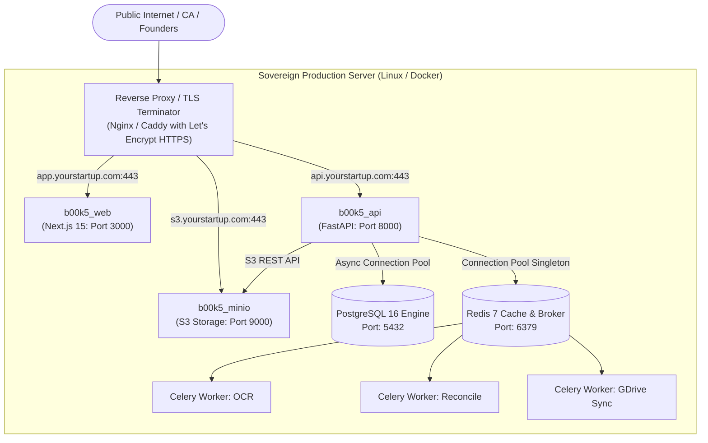

# b00k5 Production Deployment & Installation Guide

## 1. Production Architecture Overview

**b00k5** is engineered for sovereign, local-first, self-hosted deployment. All corporate financial records, bank statements, legal documents, and cryptographic audit trails remain strictly within your infrastructure perimeter.



---

## 2. Server Sizing & Hardware Recommendations

| Deployment Tier | Monthly Transactions | Active Users | Recommended Sizing | Storage (NVMe SSD) |
| :--- | :--- | :--- | :--- | :--- |
| **Startup / Single Org** | Up to 1,000 | 1 - 5 | 2 vCPU, 4 GB RAM | 25 GB |
| **Growth / Multi-Org** | 1,000 - 10,000 | 5 - 20 | 4 vCPU, 8 GB RAM | 50 GB |
| **Enterprise / CA Practice** | 10,000+ | 20+ | 8 vCPU, 16 GB RAM | 150 GB |

* **Recommended Operating System:** Ubuntu 22.04 LTS, Debian 12, or Rocky Linux 9.
* **Storage Type:** High-IOPS NVMe SSD recommended for fast OCR parsing and PostgreSQL commit performance.

---

## 3. Step-by-Step Installation

### 3.1 Install Docker & Docker Compose
```bash
# Update packages and install Docker Engine
sudo apt update && sudo apt install -y curl git ufw

# Install Docker via official script
curl -fsSL https://get.docker.com -o get-docker.sh
sudo sh get-docker.sh

# Enable Docker service and grant user access
sudo systemctl enable --now docker
sudo usermod -aG docker $USER
newgrp docker
```

### 3.2 Clone Repository & Configure Production Secrets
```bash
# Clone the repository
git clone https://github.com/aryix-hq/b00k5.git /opt/b00k5
cd /opt/b00k5

# Generate secure random passphrases
DB_PASS=$(openssl rand -hex 24)
MINIO_PASS=$(openssl rand -hex 24)
JWT_SECRET=$(openssl rand -hex 32)

# Create production .env file
cp .env.example .env
chmod 600 .env

# Update credentials in .env
sed -i "s/your_secure_db_password_here/$DB_PASS/" .env
sed -i "s/your_secure_minio_password_here/$MINIO_PASS/" .env
sed -i "s/your_jwt_secret_key_here/$JWT_SECRET/" .env
sed -i "s|NEXT_PUBLIC_API_URL=http://localhost:8000|NEXT_PUBLIC_API_URL=https://api.yourstartup.com|" .env
sed -i "s|NEXT_PUBLIC_BRIDGE_URL=http://localhost:28045|NEXT_PUBLIC_BRIDGE_URL=http://127.0.0.1:28045|" .env
```

### 3.3 Deploy the Container Fleet
```bash
# Build and launch all production containers in background
docker compose up -d --build

# Verify container health
docker compose ps
```

---

## 4. Production Reverse Proxy Configuration (Nginx & SSL)

### 4.1 Install Nginx & Certbot
```bash
sudo apt install -y nginx certbot python3-certbot-nginx
```

### 4.2 Nginx Server Configuration (`/etc/nginx/sites-available/b00k5.conf`)
```nginx
# Rate Limiting Zone
limit_req_zone $binary_remote_addr zone=b00k5_api_limit:10m rate=20r/s;

# 1. Web Application (Frontend)
server {
    server_name app.yourstartup.com;

    location / {
        proxy_pass http://127.0.0.1:3000;
        proxy_http_version 1.1;
        proxy_set_header Upgrade $http_upgrade;
        proxy_set_header Connection 'upgrade';
        proxy_set_header Host $host;
        proxy_set_header X-Real-IP $remote_addr;
        proxy_set_header X-Forwarded-For $proxy_add_x_forwarded_for;
        proxy_set_header X-Forwarded-Proto $scheme;
    }
}

# 2. FastAPI Core Engine
server {
    server_name api.yourstartup.com;
    client_max_body_size 50M; # Accommodate high-res scanned PDFs / statements

    location / {
        limit_req zone=b00k5_api_limit burst=30 nodelay;
        proxy_pass http://127.0.0.1:8000;
        proxy_http_version 1.1;
        proxy_set_header Host $host;
        proxy_set_header X-Real-IP $remote_addr;
        proxy_set_header X-Forwarded-For $proxy_add_x_forwarded_for;
        proxy_set_header X-Forwarded-Proto $scheme;

        # Disable buffering for large streaming exports
        proxy_buffering off;
        proxy_read_timeout 300s;
    }
}

# 3. MinIO S3 Object Storage API
server {
    server_name s3.yourstartup.com;
    client_max_body_size 100M;

    location / {
        proxy_pass http://127.0.0.1:9000;
        proxy_http_version 1.1;
        proxy_set_header Host $http_host;
        proxy_set_header X-Real-IP $remote_addr;
        proxy_set_header X-Forwarded-For $proxy_add_x_forwarded_for;
        proxy_set_header X-Forwarded-Proto $scheme;
    }
}
```

### 4.3 Issue SSL Certificates via Let's Encrypt
```bash
sudo ln -s /etc/nginx/sites-available/b00k5.conf /etc/nginx/sites-enabled/
sudo nginx -t
sudo certbot --nginx -d app.yourstartup.com -d api.yourstartup.com -d s3.yourstartup.com
```

---

## 5. Automated Backups & Disaster Recovery Cron

### 5.1 Configure Nightly Automated Backup Cron
Create a backup script at `/opt/b00k5/scripts/nightly_backup.sh`:

```bash
#!/bin/bash
set -euo pipefail

BACKUP_DIR="/opt/b00k5/backups"
TIMESTAMP=$(date +"%Y%m%d_%H%M%S")
BACKUP_FILE="${BACKUP_DIR}/b00k5_db_${TIMESTAMP}.dump"
ENC_BACKUP_FILE="${BACKUP_FILE}.enc"

mkdir -p "$BACKUP_DIR"

# 1. Execute compressed PostgreSQL dump
docker exec b00k5_postgres pg_dump -U b00k5_admin -Fc b00k5_db > "$BACKUP_FILE"

# 2. Encrypt dump using AES-256-GCM
openssl enc -aes-256-gcm -salt -in "$BACKUP_FILE" -out "$ENC_BACKUP_FILE" -pass file:/opt/b00k5/.backup_secret

# 3. Remove raw unencrypted dump
rm -f "$BACKUP_FILE"

# 4. Retain 30 days of local backups
find "$BACKUP_DIR" -type f -name "*.enc" -mtime +30 -delete

echo "[$(date)] Backup completed: ${ENC_BACKUP_FILE}"
```

Make executable and register in crontab:
```bash
openssl rand -hex 32 > /opt/b00k5/.backup_secret
chmod 600 /opt/b00k5/.backup_secret
chmod +x /opt/b00k5/scripts/nightly_backup.sh

# Run nightly at 02:00 AM
(crontab -l 2>/dev/null; echo "0 2 * * * /opt/b00k5/scripts/nightly_backup.sh >> /var/log/b00k5_backup.log 2>&1") | crontab -
```

### 5.2 Validate SRE Disaster Recovery Ready State
Run the automated disaster recovery drill to verify that your production system meets the $< 30\text{s}$ RTO SLA and zero ledger drift guarantee:

```bash
docker exec b00k5_api python /app/scripts/dr_drill.py
```

---

## 6. Upgrades & Rolling Maintenance

### 6.1 Executing Safe Platform Upgrades
```bash
cd /opt/b00k5

# 1. Create immediate pre-upgrade backup
/opt/b00k5/scripts/nightly_backup.sh

# 2. Pull latest code
git pull origin main

# 3. Rebuild and restart application containers
docker compose build b00k5_api b00k5_web
docker compose up -d

# 4. Run automated test suite inside container
docker exec b00k5_api pytest /app/tests/accounting_core
```

