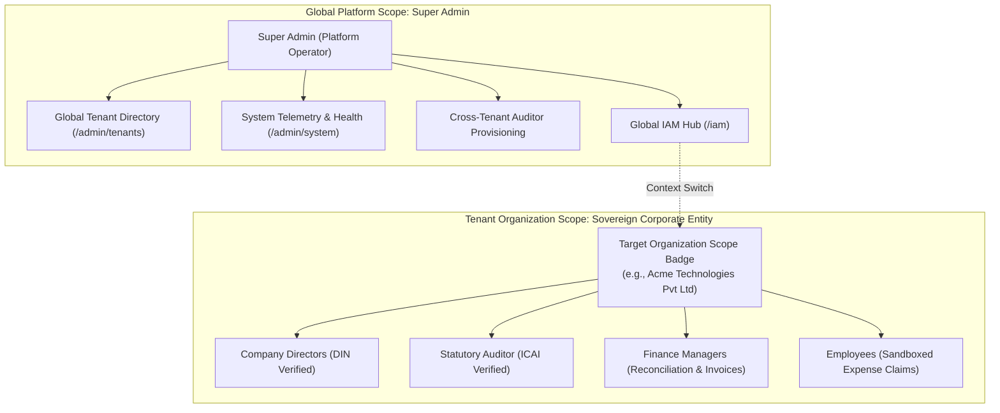

# b00k5 Platform — IAM & Governance Architecture

**Author:** Principal Security Architect, CISO, and Legal Governance Group  
**Statutory Basis:** Companies Act 2013 (§128, §173, §174), Information Technology Act 2000 (§3, §3A - Digital Signatures)  
**Classification:** Technical Architecture & Security Specification  
**Version:** 2.0.0 (October 2026)

---

## 1. The Core Architectural Debate: Global IAM vs Tenant Team & Access

A recurring dilemma in multi-tenant financial ERPs is the collision between **Global Platform Administration** and **Tenant-Level Corporate Governance**:



### Key Architectural Resolutions:
1. **Unification into `/iam`:** To prevent fragmented user tables and divergent APIs (`/api/v1/tenants/members` vs `/api/v1/tenant-iam/members`), all identity management is centralized under `/iam`.
2. **Elimination of Sidebar Duplication:** In Super Admin mode, the navigation displays a single, top-level **"Global IAM & Access"** entry under Platform Administration. The redundant "Team & Access" link under Statutory Governance is removed for Super Admins. For standard tenant owners, the navigation displays **"Team & Access (IAM)"** scoped to their company.
3. **Target Organization Scope Badge:** When managing members in `/iam`, the UI displays a clear visual badge showing the active legal name, CIN, and tenant ID. Super Admins receive an interactive switcher to explicitly target the desired corporate entity prior to inviting members.

---

## 2. Statutory Role-Based Access Control (RBAC) Matrix

Under Indian corporate law, internal segregation of duties (SoD) is mandatory to prevent fraud and maintain audit integrity:

| Statutory Role | Designated Scope | Hardware DSC Signing | General Ledger Access | Bank Feeds & Reconcile | Expense Claims | Schedule III Audit Pack |
| :--- | :--- | :---: | :---: | :---: | :---: | :---: |
| **Director / Sovereign Founder (`owner`)** | Full Administrative Legal & Financial Authority | **YES (PKCS#11)** | Full Read/Write | Full Access | Full Access | Full Access & Sign |
| **Statutory Auditor (`auditor_ca`)** | Statutory Audit Verification & Adjusting Entries | Read Verification Only | Read-Only Audit File | Read-Only Verifier | Read-Only Verifier | **1-Click Export** |
| **Finance Manager / CFO (`finance_manager`)** | Day-to-Day Operations & Financial Accounting | No | Read/Write (Vouchers) | Full Access | Approve Claims | Read-Only |
| **Staff / Employee (`employee`)** | Out-of-Pocket Expense Submission Portal | No | **STRICTLY BLOCKED** | **STRICTLY BLOCKED** | Submit / View Own | **STRICTLY BLOCKED** |

---

## 3. Statutory Verification & Credentials

1. **Director Identification Number (DIN) Verification:**
   - When assigning the role of `owner` / Director, the user must supply an 8-digit DIN verified via MCA Form DIR-3 approval letter.
   - The platform includes a direct document analyzer to parse and verify DIR-3 approval letters automatically.
2. **Chartered Accountant (ICAI) Credentials:**
   - When inviting a Statutory Auditor, their 6-digit ICAI Membership Number and Firm Registration Number (FRN) are recorded.
   - Auditor accounts operate under strict **Zero-Edit Isolation**: they can inspect trial balances, drill into transaction lines, view original uploaded vouchers, and post adjusting entries, but cannot tamper with posted business vouchers.

---

## 4. Multi-Tenant Row-Level Security (RLS) Penetration Defense

Multi-tenancy is not enforced in application memory; it is cryptographically and relationally guaranteed at the PostgreSQL engine level:

```sql
-- Enforced on every tenant-scoped table in b00k5
ALTER TABLE journal_entries ENABLE ROW LEVEL SECURITY;
ALTER TABLE journal_entries FORCE ROW LEVEL SECURITY;

CREATE POLICY tenant_isolation_policy ON journal_entries
    FOR ALL
    USING (tenant_id = NULLIF(current_setting('app.current_tenant', true), '')::UUID);
```

Every incoming API request checked out from the SQLAlchemy connection pool runs inside a transaction block setting:
```sql
SET LOCAL app.current_tenant = :tenant_id;
SET LOCAL app.current_user_role = :role;
```
If an adversary attempts to inject headers or query another tenant's documents, PostgreSQL RLS returns zero rows (`[]`), preventing cross-tenant data leakage.

