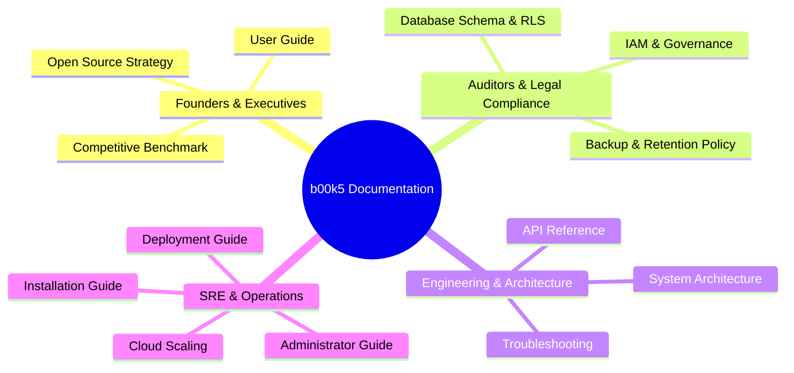

# b00k5 Documentation Portal

Welcome to the official documentation for **b00k5**, the open-source, local-first Indian financial ERP and MCA compliance platform.

---

## 📚 Documentation Directory

### 1. 💼 Founders, CFOs & Business Leaders
- **[Competitive Benchmark & Market Differentiation](COMPETITIVE_BENCHMARK.md):** Comprehensive head-to-head analysis comparing `b00k5` with Tally Prime, Zoho Books, QuickBooks India, ClearTax, and Khatabook.
- **[User Guide](USER_GUIDE.md):** Operational walkthroughs for invoicing, recording vendor bills, 3-tier bank feeds, expense reimbursements, and financial closing.
- **[Open Source Strategy](OPEN_SOURCE_STRATEGY.md):** Vision for local-first corporate accounting sovereignty in India.

### 2. ⚖️ Statutory Compliance, Auditors (CA) & Company Secretaries (CS)
- **[Statutory Backup, Disaster Recovery & Retention Policy](BACKUP_AND_DISASTER_RECOVERY_POLICY.md):** Complete statutory retention schedules under Companies Act §128(5), Income Tax Act §44AA/§149, CGST Act §36, RPO/RTO objectives, and AES-256-GCM dual-layer backups.
- **[IAM & Corporate Governance Architecture](IAM_AND_GOVERNANCE_ARCHITECTURE.md):** Role-based access control (RBAC), DIN verification via DIR-3, ICAI auditor isolation, and the resolution of Global vs Tenant scoping.
- **[Database Schema & RLS Invariants](DATABASE_SCHEMA.md):** PostgreSQL 16 schema documentation, financial CHECK constraints, ledger immutability triggers, and Row-Level Security policies.

### 3. 🛠️ Systems Architecture & Software Engineers
- **[System Architecture](ARCHITECTURE.md):** High-level component interactions, FastAPI backend, Next.js 15 App Router, Redis task queues, and MinIO object storage.
- **[API Reference](API_REFERENCE.md):** OpenAPI/Swagger REST endpoint documentation for ledger, invoices, banking, compliance, and vault APIs.
- **[Troubleshooting & Diagnostics](TROUBLESHOOTING.md):** Diagnostic playbooks for common operational failures, connection resets, and environment anomalies.

### 4. 🚀 SRE, DevOps & Cloud Deployment
- **[Administrator Guide](ADMIN_GUIDE.md):** Platform operations, multi-tenant onboarding, certificate management, and system telemetry monitoring.
- **[Installation Guide](INSTALLATION_GUIDE.md):** Step-by-step installation instructions for local development and bare-metal environments.
- **[Deployment Guide](DEPLOYMENT_GUIDE.md):** Production Docker Compose configuration, healthcheck tuning, and zero-downtime rolling updates.
- **[Cloud Deployment & Scaling Guide](CLOUD_DEPLOYMENT_GUIDE.md):** Production cloud topologies on AWS, Hetzner, DigitalOcean, and private on-premises Kubernetes.

