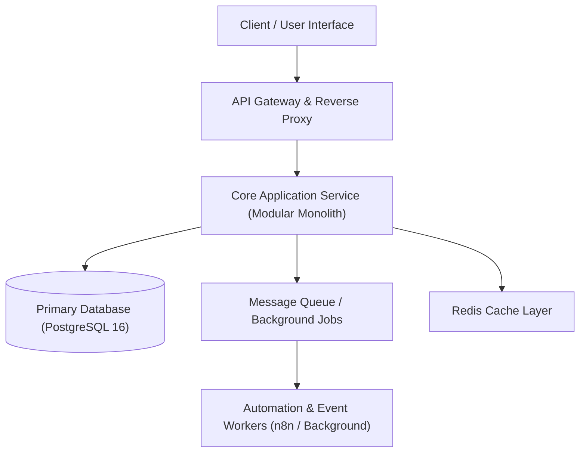

# Living System Architecture

> **Custodian**: System Architect & Staff Engineer (`@architect`)  
> **Status**: Living Architectural Specification  
> **Last Synchronized**: 2026-10-17  

This document serves as the single source of truth for high-level system topology, domain boundaries, data pipelines, API contracts, and trade-offs.

---

## 1. System Topology Overview

---

## 2. Architectural Invariants
1. **Modular Monolith First**: Keep services cohesive within clear domain modules before prematurely distributing over network boundaries.
2. **Strict API Contracts**: All cross-module and client-facing interfaces must define explicit typed schemas.
3. **Database Boundary Protection**: No direct cross-domain table writes; state modifications occur strictly via domain service layers.
4. **Local-First & Ephemeral Previews**: The entire system must be runnable locally in Docker and verify cleanly via `bin/deploy-preview.sh`.

---

## 3. Architecture Decision Records (ADR Index)

All structural changes to schemas, frameworks, or security boundaries must be debated via `@orchestrator-debate` and recorded in `wiki/adr/`:

| ADR ID | Title | Status | Date | Decision Summary |
| :--- | :--- | :--- | :--- | :--- |
| [`ADR-001`](./adr/ADR-001.md) | Modular Monolith & Postgres RLS | Accepted | 2026-10-17 | Enforce tenant isolation via PostgreSQL RLS |

