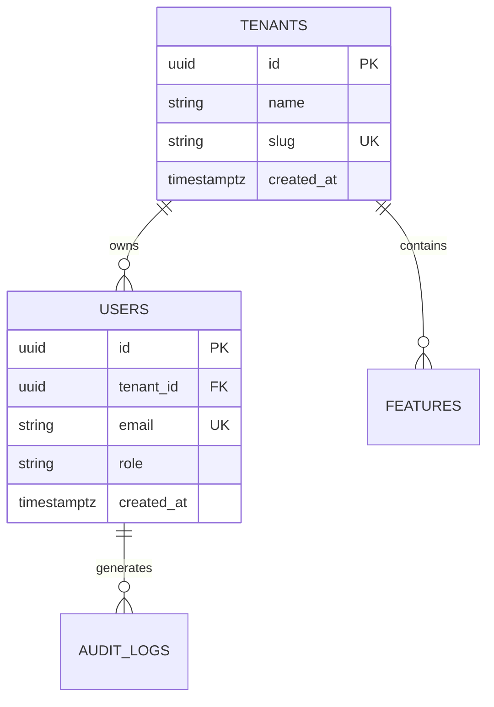

# Living Database Schema Specification

> **Custodian**: Database Architect & DBA (`@database-architect`)  
> **Target Database Engine**: PostgreSQL 16+  
> **Status**: Living Schema Specification  
> **Last Synchronized**: 2026-10-17  

This document tracks all relational models, table definitions, foreign key constraints, indexes, connection pooling invariants, and Row-Level Security (RLS) policies.

---

## 1. Schema Conventions & Invariants
1. **Primary Keys**: Use `UUIDv7` or bigserial integer IDs.
2. **Audit Timestamps**: Every table must have `created_at TIMESTAMPTZ DEFAULT NOW()` and `updated_at TIMESTAMPTZ DEFAULT NOW()`.
3. **Row-Level Security (RLS)**:
   - Every multi-tenant table MUST enable `ALTER TABLE <table_name> ENABLE ROW LEVEL SECURITY;` and `FORCE ROW LEVEL SECURITY`.
   - Tenant isolation policy: `USING (tenant_id = current_setting('app.current_tenant_id')::uuid)`.
4. **Deadlock Elimination**: Queries modifying multiple rows must consistently sort targets (`ORDER BY id ASC FOR UPDATE`).
5. **Connection Pooling**: Use PgBouncer in transaction mode; never rely on unbounded application connection pools.

---

## 2. Table Catalog & Relations

---

## 3. Migration Ledger & History

| Migration File | Applied Date | Author | Description | RLS Enforced |
| :--- | :--- | :--- | :--- | :---: |
| `0001_initial_schema.sql` | 2026-10-17 | DBA | Baseline tenant & user schema | Yes |

