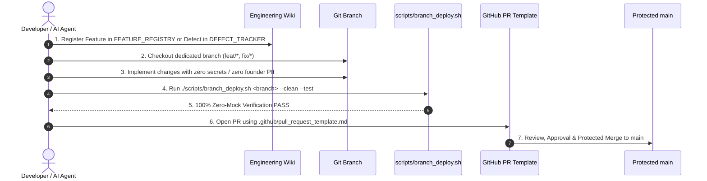

# b00k5 Engineering Workflow & Contribution Standards

This document establishes the mandatory engineering rules, branching strategies, and Pull Request lifecycle for all developers and AI coding agents operating on `b00k5`.

---

## 🛑 Rule #1: The Main Branch Protection Policy

> **DIRECT COMMITS AND DIRECT MERGES TO `main` ARE STRICTLY PROHIBITED.**
> All changes must originate from an isolated feature or defect branch and be merged solely via a reviewed Pull Request that passes 100% of automated zero-mock tests.

---

## 🌿 Branch Naming Taxonomy

All branches cut from `main` must adhere to this standardized format:

| Branch Type | Syntax | Example | Purpose |
| :--- | :--- | :--- | :--- |
| **New Feature** | `feat/<module>-<short-description>` | `feat/invoice-einvoice-qr` | New statutory, banking, or UI capability. |
| **Defect Remediation** | `fix/<defect-id>-<short-description>` | `fix/def-06-igst-desync` | Bug fixes referencing `wiki/DEFECT_TRACKER.md`. |
| **Architectural Refactor** | `refactor/<module>-<scope>` | `refactor/ledger-lock-engine` | Code quality, latency, or decoupling. |
| **Documentation & Wiki** | `docs/<scope>` | `docs/open-source-strategy` | Updates to guides, wikis, or OpenAPI specs. |
| **SRE & DevOps** | `chore/<scope>` | `chore/branch-deploy-script` | Docker, CI/CD, or deployment scripts. |

---

## 🛠️ Build & Branch Deployment Strategy

To test any branch without modifying or endangering `main`, use the branch deployment automation script:

```bash
# Basic deployment: check out branch, build, and deploy
./scripts/branch_deploy.sh <branch-name>

# Clean deployment: wipe previous test state, build, and deploy with fresh DB
./scripts/branch_deploy.sh <branch-name> --clean

# Full verification: deploy and execute integration and Selenium E2E test suites
./scripts/branch_deploy.sh <branch-name> --clean --test
```

### What `scripts/branch_deploy.sh` Does:
1. Validates working tree cleanliness (warns if unstaged changes exist).
2. Checks out the target branch safely.
3. Builds container images (`docker compose build`).
4. In `--clean` mode, cleanly destroys volumes (`docker compose down -v`) and mounts a pristine PostgreSQL 16 database.
5. Starts all containers (`docker compose up -d`) and polls container healthchecks until healthy.
6. In `--test` mode, executes pytest zero-mock suites and captures Selenium screenshots.
7. Outputs live telemetry and status URLs.

---

## 📝 The Pull Request Lifecycle



### Pre-PR Checklist:
- [ ] Registered in `wiki/FEATURE_REGISTRY.md` or `wiki/DEFECT_TRACKER.md`.
- [ ] No private API secrets, database passwords, or JWT keys in code.
- [ ] No real founder PII (No real PAN, Aadhaar, bank accounts, or phone numbers).
- [ ] All monetary calculations use `Decimal(15, 2)` Banker's Rounding.
- [ ] Double-entry ledger balance $| \sum \text{Debits} - \sum \text{Credits} | \equiv 0.00$.
- [ ] Customer tax invoices and MCA minutes have **0 vendor watermarks**.
- [ ] Automated zero-mock tests pass completely against Docker.
- [ ] Commit signed off with DCO (`git commit -s`).
