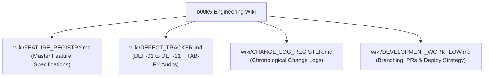

# b00k5 Engineering Wiki & Traceability Portal

Welcome to the **b00k5 Engineering Wiki**. This directory serves as the immutable audit trail and single source of truth for all architectural decisions, feature specifications, defect tracking, and change logs.

---

## 🏛️ Governance Policy: "Zero Random Coding" Mandate

To maintain enterprise-grade reliability, strict statutory compliance, and open-source excellence, **no code may be written or submitted randomly**:

1. **Every Feature must have an entry in [`FEATURE_REGISTRY.md`](FEATURE_REGISTRY.md)** with explicit statutory citations (Companies Act, CGST Act, Income Tax Act) and acceptance criteria.
2. **Every Bug or Regression must have an entry in [`DEFECT_TRACKER.md`](DEFECT_TRACKER.md)** with root cause analysis, severity tier, and zero-mock verification test reference.
3. **Every Pull Request must link to a Wiki ID** in [`.github/pull_request_template.md`](../.github/pull_request_template.md) and be recorded in [`CHANGE_LOG_REGISTER.md`](CHANGE_LOG_REGISTER.md).
4. **Direct Commits to `main` are Strictly Prohibited.** All development occurs on isolated branches (`feat/*`, `fix/*`, `chore/*`) and deploys via [`scripts/branch_deploy.sh`](../scripts/branch_deploy.sh).

---

## 📚 Wiki Directory Index

| Wiki Document | Purpose | Target Audience |
| :--- | :--- | :--- |
| **[`FEATURE_REGISTRY.md`](FEATURE_REGISTRY.md)** | Comprehensive index of all core financial, statutory, secretarial, and SRE modules with requirement IDs and statutory references. | Product Managers, CAs, CSs, Engineers |
| **[`DEFECT_TRACKER.md`](DEFECT_TRACKER.md)** | Complete defect lifecycle registry tracking DEF-01 to DEF-21, TAB-FY issues, remediation status, and automated test proof. | QA Testers, Security Auditors, SREs |
| **[`CHANGE_LOG_REGISTER.md`](CHANGE_LOG_REGISTER.md)** | Chronological register of all commits, pull requests, refactors, and migrations with impact assessments. | Developers, Open-Source Contributors |
| **[`DEVELOPMENT_WORKFLOW.md`](DEVELOPMENT_WORKFLOW.md)** | Step-by-step developer manual: branch naming, pre-flight testing, branch deployment scripts, and PR template protocol. | All Engineers & AI Coding Agents |

---

## 🧭 Invariant Standards Summary
1. **Ledger Balance:** $\left\vert{}\sum \text{Debits} - \sum \text{Credits}\right\vert{} \equiv 0.00$ enforced at DB level.
2. **PostgreSQL RLS Multi-Tenancy:** `SET LOCAL app.current_tenant` & `app.current_user_role` on every query.
3. **Statutory Document Neutrality:** Invoices and MCA minutes remain 100% tenant-owned with **zero third-party vendor watermarks**.
4. **Open-Source Confidentiality:** Zero secrets, zero private keys, and zero founder PII in git history.
