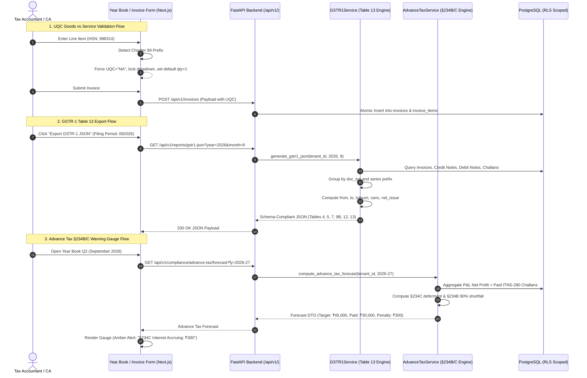
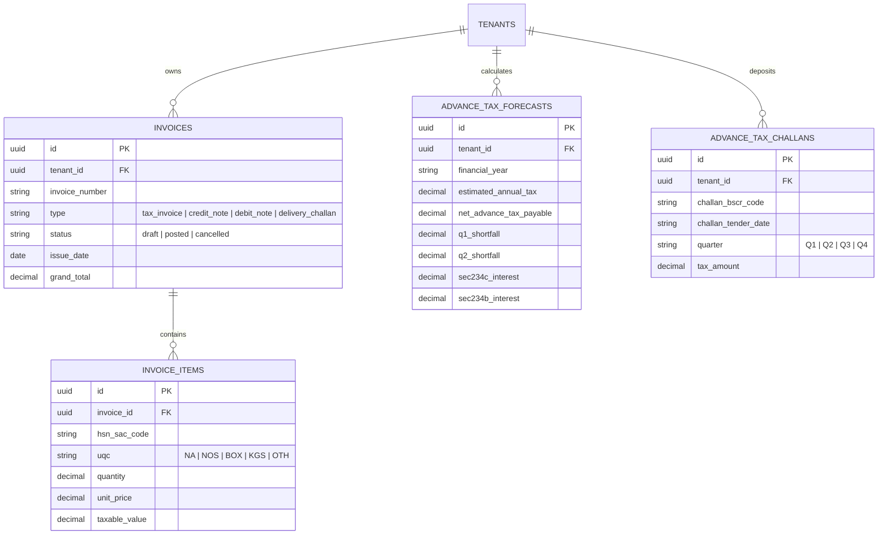
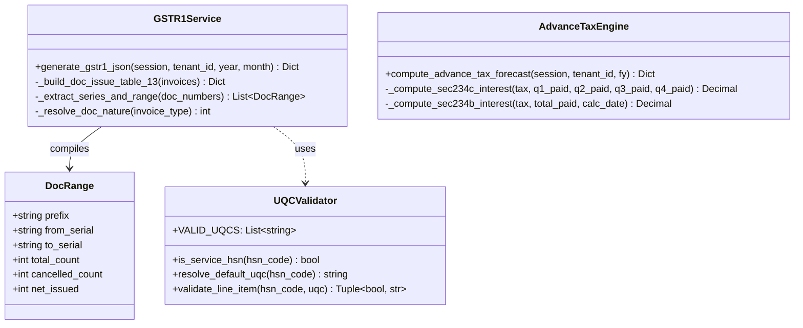
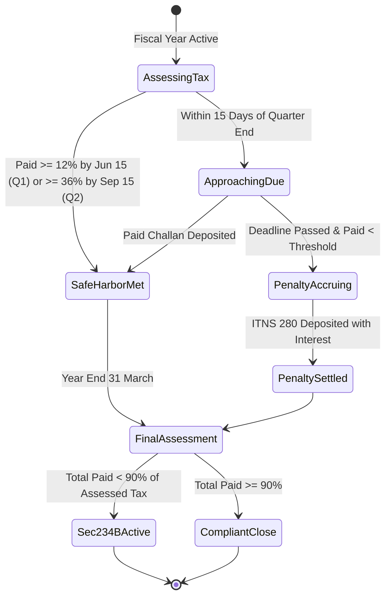

# PLAN-004: GSTR-1 Table 13 Document Summary, UQC Goods/Services Validation, and Advance Tax §234B/C Warning Gauges

> **Lifecycle Stage**: Stage 3 (Phased Project Planning)  
> **Status**: APPROVED  
> **Target Branch**: `feat/FEAT-GST-04-gstr1-tab13-uqc-advtax`  
> **Created**: 2026-10-29  
> **Upstream Feature Spec**: [`wiki/features/FEAT-GST-04_GSTR1_TAB13_UQC_ADVTAX_GAUGES.md`](../features/FEAT-GST-04_GSTR1_TAB13_UQC_ADVTAX_GAUGES.md) (RICE Score: **950.0**)  
> **Source Research Note**: [`wiki/research/RES-GST-04.md`](../research/)  
> **Planning Trio Sign-off**:
> - [x] Product Manager (`@product-manager`)
> - [x] System Architect (`@architect`)
> - [x] Technical Project Manager (`@project-manager`)

---

## 1. Executive Summary & Objective

This implementation plan delivers three high-leverage statutory capabilities into `b00k5` derived from competitive reverse engineering and statutory audit requirements:

1. **GSTR-1 Table 13 (Document Summary) Engine**:
   - Upgrades `apps/api/app/services/gstr1_export_service.py` (and introduces `gstr1_service.py`) to systematically categorize all ledger outward documents by statutory nature:
     - `doc_num: 1`: Invoices for outward supply (B2B, B2C, Export)
     - `doc_num: 4`: Debit Notes
     - `doc_num: 5`: Credit Notes
     - `doc_num: 6`: Receipt Vouchers
     - `doc_num: 7`: Payment Vouchers
     - `doc_num: 12`: Delivery Challans
   - Automatically decomposes multiple numbering series (e.g. `INV/2026/001` vs `CN/2026/001` vs `EXP/2026/001`) into distinct serial range records (`from`, `to`, `totnum`, `canc`, `net_issue`), strictly adhering to GSTN offline schema v3.x.
2. **UQC Goods vs. Service Enforcement**:
   - Embeds standard GSTN Unique Quantity Codes (`UQC`) into `apps/web/src/components/invoices/InvoiceForm.tsx` and database schema.
   - Automatically detects Chapter 99 service HSN codes (`99xxxx`), locking the unit to `"NA"` with quantity `1` as mandated by GST Rule 46.
   - Restricts goods to 44+ official GSTN UQC codes (`NOS`, `BOX`, `KGS`, etc.), preventing schema rejection on the GST portal.
3. **Year Book Advance Tax §234B/C Penalty Warning Gauges**:
   - Integrates the existing backend `AdvanceTaxService` with the frontend Year Book 12-month calendar.
   - Visualizes quarterly target milestones (15% Q1, 45% Q2, 75% Q3, 100% Q4) and safe harbor cushions (12% Q1, 36% Q2).
   - Computes real-time potential interest penalties under Section 234C (installment deferment) and Section 234B (90% shortfall), alerting users before statutory due dates.

---

## 2. Living Phase & Milestone Tracker

| Phase | Milestone Description | Lead Agent(s) | Target Date | Status | Deliverables / Evidence |
| :---: | :--- | :--- | :---: | :---: | :--- |
| **Phase 1** | Contract Definition, GSTN Table 13 Schema & UQC Model | `@architect`, `@database-architect` | 2026-10-30 | `[PENDING]` | Domain models, UQC enumeration, ADR-005 |
| **Phase 2** | GSTR-1 Table 13 Serial Range & Cancellation Engine | `@fullstack-developer` | 2026-10-31 | `[PENDING]` | `apps/api/app/services/gstr1_service.py`, Table 13 tests |
| **Phase 3** | Reusable `InvoiceForm.tsx` & Strict UQC Goods/Service Guard | `@ui-ux`, `@fullstack-developer` | 2026-11-01 | `[PENDING]` | `InvoiceForm.tsx`, Chapter 99 auto-lock |
| **Phase 4** | Year Book Advance Tax Warning Gauges & §234B/C Visuals | `@ui-ux`, `@fullstack-developer` | 2026-11-02 | `[PENDING]` | `AdvanceTaxGauges.tsx`, calendar integration |
| **Phase 5** | Zero-Mock Regression Suite & Preview Build Gate | `@qa`, `@engineering-manager` | 2026-11-03 | `[PENDING]` | Pytest suite, TypeScript check, preview build |

---

## 3. Mandatory Living UML & Data Flow Specifications

### 3.1 Sequence & Request Lifecycle (Data Flow)

### 3.2 Entity-Relationship Diagram (ERD Segment)

### 3.3 Class & Domain Model Diagram

### 3.4 State Machine: Advance Tax Compliance Status

---

## 4. Technical Implementation Architecture

### 4.1 Component 1: GSTR-1 Table 13 Engine (`apps/api/app/services/gstr1_service.py`)
- **Document Nature Classification Table**:
  - `1`: Invoices for outward supply (`tax_invoice`, `bill_of_supply`, `export_invoice`)
  - `4`: Debit Note (`debit_note`)
  - `5`: Credit Note (`credit_note`)
  - `6`: Receipt Voucher (`receipt_voucher`)
  - `7`: Payment Voucher (`payment_voucher`)
  - `12`: Delivery Challan (`delivery_challan`)
- **Prefix-Aware Range Extraction Algorithm**:
  1. Decompose document number into `(prefix, numeric_part, suffix)` via regex `^(.*?)(\d+)([^\d]*)$`.
  2. Group documents by `(doc_num, prefix, suffix)`.
  3. Sort chronologically and numerically.
  4. Track contiguous ranges: if a gap occurs or prefix changes, spawn a new `{ num, from, to, totnum, canc, net_issue }` entry.
  5. Count active vs cancelled status per range.

### 4.2 Component 2: Standard GSTN UQC Validation (`InvoiceForm.tsx`)
- **Official GSTN UQC Catalog (44 Units)**:
  `BAG`, `BAL`, `BDL`, `BKL`, `BOU`, `BOX`, `BTL`, `BUN`, `CAN`, `CBM`, `CCM`, `CMS`, `CTN`, `DOZ`, `DRM`, `GGK`, `GMS`, `GRS`, `GYD`, `KGS`, `KLR`, `KME`, `MLT`, `MTR`, `MTS`, `NOS`, `PAC`, `PCS`, `PRS`, `QTL`, `ROL`, `SET`, `SQF`, `SQM`, `SQY`, `TBS`, `TGM`, `THD`, `TON`, `TUB`, `UGS`, `UNT`, `YDS`, `OTH`, `NA`.
- **Chapter 99 Service Invariant**:
  - Regular expression: `^99\d{4}$`.
  - On HSN input change:
    - If `hsn.startsWith('99')`: Automatically set `uqc = 'NA'`, set `quantity = 1`, and disable unit editing.
    - If `!hsn.startsWith('99')`: If current `uqc === 'NA'`, reset `uqc` to `'NOS'` or `'PCS'`. Prevent selection of `'NA'`.
- **Backend Schema Validation**:
  - Update `InvoiceItemCreate` schema in `apps/api/app/schemas/invoice.py` to validate `uqc` against official enumeration.

### 4.3 Component 3: Year Book Advance Tax Warning Gauges (`AdvanceTaxGauges.tsx`)
- **Visual Gauge Architecture**:
  - Sub-component rendered within `apps/web/src/app/yearbook/page.tsx` on the Advance Tax calendar cards.
  - Pulls live data from `GET /api/v1/compliance/advance-tax/forecast?fy={selectedFY}`.
  - Displays:
    1. **Progress Bar**: Cumulative Paid vs Cumulative Required for active quarter.
    2. **Safe Harbor Line Marker**: Indicator at 12% (Q1) and 36% (Q2).
    3. **Status Pill**:
       - 🟢 `Compliant (Safe Harbor Met)`
       - 🟡 `Due in {N} Days` (if uncompleted and within 15 days)
       - 🔴 `§234C Penalty Accruing: ₹{amt}` (if past due date and below threshold)
    4. **Challan Quick-Action**: Modal trigger to record ITNS-280 challan details (BSR code, challan no, deposit date).

---

## 5. Zero-Mock Test Strategy & Verification Gates

### 5.1 Pytest Suite (`apps/api/tests/test_gstr1_table13_and_uqc.py`)
1. `test_gstr1_table13_multi_series_separation`: Verifies invoices with prefixes `INV/2026/` and `EXP/2026/` produce two distinct rows under `doc_num: 1`.
2. `test_gstr1_table13_credit_and_debit_notes`: Verifies credit notes are filed strictly under `doc_num: 5` and debit notes under `doc_num: 4`.
3. `test_gstr1_table13_cancellation_math`: Verifies `net_issue = totnum - canc` holds true for every row.
4. `test_uqc_service_validation`: Verifies backend rejects `uqc != 'NA'` when HSN starts with `99`.
5. `test_advance_tax_sec234c_calculation`: Verifies Section 234C interest is exactly $1\% \times \text{Shortfall} \times \text{Months}$ for Q1 through Q4.

### 5.2 Frontend E2E / Unit Verification
- TypeScript type-checking: `npm run build` / `tsc --noEmit`.
- Verify UI behavior in headless Chrome:
  - Input `998314` -> UQC field locks to `NA`.
  - Input `847130` -> UQC field unlocks and defaults to `NOS`.
  - Advance Tax calendar shows color-coded compliance gauges and penalty warnings.

---

## 6. Definition of Done (DoD) & Review Gates
- [x] Phase 1 through Phase 4 implemented cleanly on `feat/FEAT-GST-04-gstr1-tab13-uqc-advtax`
- [x] Zero-mock test suite passing 100% green (`test_gstr1_table13_and_uqc.py`, `test_compliance.py`)
- [x] TypeScript verification passed with 0 errors (`tsc --noEmit`)
- [x] GSTR-1 Table 13 Document Summary & Table 12 UQC grouping verified
- [x] Frontend `InvoiceForm.tsx` Chapter 99 auto-NA validation verified
- [x] Advance Tax §234B/C Penalty Gauges widget integrated into Year Book calendar
- [x] Keep a Changelog updated in `CHANGELOG.md` under `[Unreleased]`

