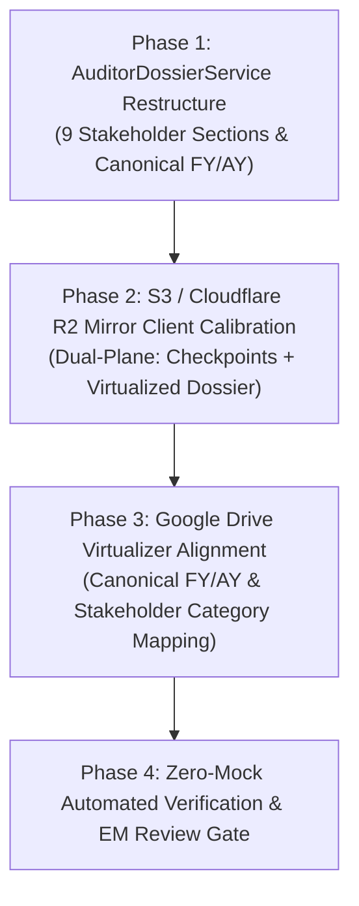

# Stage 3: Engineering Execution Plan — Stakeholder Dossier & Dual-Plane BCP Backup
**Plan ID**: PLAN-006  
**Related Spec**: FEAT-OPS-06 / RES-006  
**Authors**: Planning Trio (Staff Architect, DevOps SRE, Principal CA)  
**Status**: In Progress  

---

## 1. Technical Architecture & Phasing

---

## 2. Milestone Decomposition

### Milestone 1: Refactor `AuditorDossierService`
- **File**: `apps/api/app/services/auditor_dossier_service.py`
- **Tasks**:
  1. Restructure archive paths into the 9 role-oriented sections:
     - `00_EXECUTIVE_SUMMARY_AND_LEGAL_IDENTITY/`
     - `01_STATUTORY_FINANCIAL_STATEMENTS_SCHEDULE_III/`
     - `02_CORPORATE_GOVERNANCE_AND_SECRETARIAL_MCA/`
     - `03_TAX_COMPLIANCE_AND_STATUTORY_RETURNS/`
     - `04_BANKING_CASH_AND_TREASURY_RECONCILIATION/`
     - `05_OPERATIONS_REVENUE_AND_TRADE_RECEIVABLES/`
     - `06_OPERATIONS_EXPENSES_AND_TRADE_PAYABLES/`
     - `07_PAYROLL_PERSONNEL_AND_LABOR_LAW_COMPLIANCE/`
     - `08_AUDIT_TRAIL_AND_CRYPTOGRAPHIC_INTEGRITY/`
  2. Implement `Executive_Briefing` generation (Turnover, Profit, Tax, Compliances summary).
  3. Ensure all SHA-256 integrity digests are captured into `08_AUDIT_TRAIL_AND_CRYPTOGRAPHIC_INTEGRITY/AUDIT_AUTHENTICITY_MANIFEST_SHA256.txt`.

### Milestone 2: Dual-Plane Cloud Backup Synchronization
- **Files**: `apps/api/app/api/v1/storage.py`, `apps/api/app/services/s3_mirror_client.py`
- **Tasks**:
  1. Define canonical tenant root prefix: `{Tenant_Legal_Name}_({CIN_or_PAN})/`.
  2. Implement **Plane 1 (Disaster Recovery Checkpoints)**:
     - Preserve raw database dump and snapshot metadata under `checkpoints/CP-{TIMESTAMP}/`.
  3. Implement **Plane 2 (Statutory Dossier Mirror)**:
     - Mirror live documents (Invoices, Bills, Vault Docs, Bank Statements) into the 9 stakeholder folders under `FY {YYYY}-{YY} (AY {YYYY+1}-{YY+1})/`.
  4. Ensure retention auto-pruning operates exclusively on `checkpoints/` without deleting statutory documents.

### Milestone 3: Google Drive Virtualizer Calibration
- **File**: `apps/api/app/services/gdrive_virtualizer.py`
- **Tasks**:
  1. Update `CATEGORY_MAPPING` to route into the 9 statutory folders.
  2. Ensure `get_indian_fiscal_year` generates canonical `FY {YYYY}-{YY} (AY {YYYY+1}-{YY+1})`.

### Milestone 4: Verification, Quality Assurance & Engineering Manager Sign-Off
- **Tasks**:
  1. Run unit & integration test suites in `tests/test_storage_and_sync.py` and `tests/test_s3_remote_mirror.py`.
  2. Verify that zip generation creates valid archives with no duplicate paths or corrupt files.
  3. Update `CHANGELOG.md` adhering to Keep a Changelog standards.
  4. Submit to Engineering Manager (`@engineering-manager`) for Stage 4 DoD sign-off.

