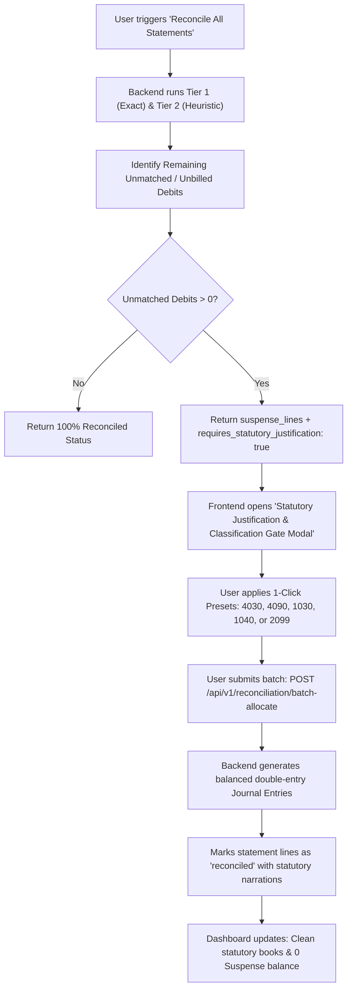

# Stage 3: Engineering Execution Plan — Statutory Reconciliation Justification & Classification Review Gate
**Plan ID**: PLAN-007  
**Related Spec**: FEAT-OPS-07 / RES-007  
**Authors**: Planning Trio (Staff Architect, Principal CA, Fullstack Lead)  
**Status**: Ready for Execution  

---

## 1. Technical Architecture & Phasing

---

## 2. Milestone Decomposition

### Milestone 1: Backend API Enhancements
- **Target File**: `apps/api/app/api/v1/reconciliation.py`
- **Tasks**:
  1. Update `POST /api/v1/reconciliation/reconcile-all`:
     - Query and collect all statement lines for tenant with `reconciliation_status in ("suspense_posted", "pending_review", "probable_match")` and `withdrawal_amount > 0` (or unmatched lines).
     - Include `id`, `statement_id`, `line_number`, `transaction_date`, `withdrawal_amount`, `deposit_amount`, `description`, `counterparty_name`, `reference_number`, `payment_channel`, and `reconciliation_status`.
     - Suggest preset categories (`bank_charges`, `unbilled_expense`, `vendor_advance`, `director_due`, `suspense`).
     - Return `suspense_lines` and `requires_statutory_justification: bool`.
  2. Create `GET /api/v1/reconciliation/pending-justifications`:
     - Returns current unbilled/suspense lines across all statements for the tenant.
  3. Create `POST /api/v1/reconciliation/batch-allocate`:
     - Request model `BatchAllocateRequest(allocations: List[BatchAllocateItem])`.
     - Resolves account codes (`4030`, `4090`, `1030`, `1040`, `2099`).
     - Posts balanced journal vouchers (`JV-ALLOC-...`).
     - Verifies debit/credit balance invariant $\sum \text{Dr} - \sum \text{Cr} = 0$.
     - Updates statement lines to `reconciled` with statutory justification stored in `notes`.

### Milestone 2: Frontend UI & Interactive Review Gate
- **Target File**: `apps/web/src/app/reconciliation/page.tsx`
- **Tasks**:
  1. Intercept `handleRunGlobalSweep`:
     - When `res.suspense_lines` is non-empty, populate state and automatically open `statutoryGateOpen = true`.
  2. Implement Statutory Alert Banner:
     - Prominent banner when pending unbilled debits exist: `"⚠️ X Unbilled Debits Require Statutory Justification [Review & Justify]"`.
  3. Build `StatutoryJustificationModal`:
     - Line items table showing Date, Amount, Payee/Description, UTR.
     - 1-click Preset buttons:
       - `[Bank Fee 4030]`
       - `[Self-Vouched 4090]`
       - `[Vendor Advance 1030]`
       - `[Director Due 1040]`
       - `[Keep in Suspense 2099]`
     - Editable narration input per line with auto-populated template.
     - Target Chart of Accounts dropdown (defaults to preset account).
     - Batch submit button calling `/api/v1/reconciliation/batch-allocate` with loading spinner and error handling.
     - Live refresh of statements and lines upon commit.

### Milestone 3: Automated Zero-Mock Verification
- **Target Files**: `apps/api/tests/test_reconciliation.py` (or new test script)
- **Tasks**:
  1. Verify `batch-allocate` creates valid double-entry journal entries.
  2. Verify debit card fees map to `4030` and unbilled expenses map to `4090`.
  3. Verify `reconcile-all` flags `requires_statutory_justification: true` when unmatched withdrawals exist.
  4. Ensure `apps/web` TypeScript type check passes (`npx tsc --noEmit`).

### Milestone 4: EM Review & Branch Protection Merge Gate
- **Tasks**:
  1. Update `CHANGELOG.md` following Keep a Changelog.
  2. Invoke `engineering-manager` subagent to review the feature diff.
  3. Merge `feat/FEAT-RECON-STATUTORY-JUSTIFICATION-GATE` into `main`.

