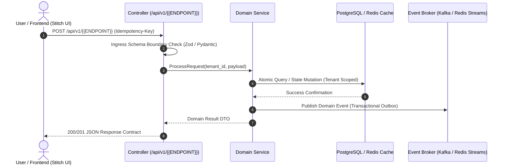
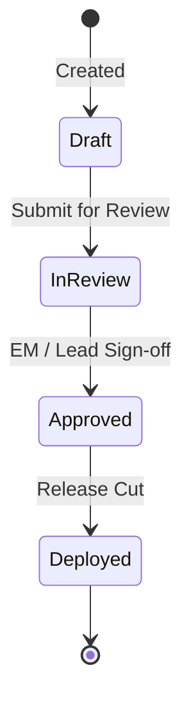
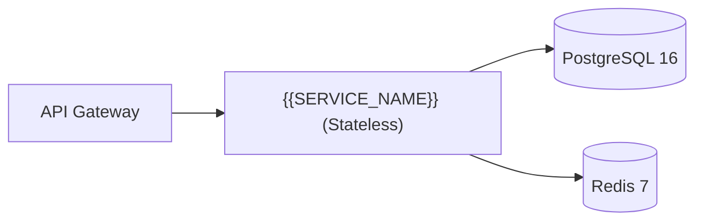

# PLAN-{{ID}}: {{TITLE}}

> **Lifecycle Stage**: Stage 3 (Phased Project Planning)  
> **Status**: [PENDING | IN_PROGRESS | COMPLETED]  
> **Target Branch**: `feat/{{BRANCH_NAME}}`  
> **Created**: {{DATE}}  
> **Upstream Feature Spec**: [`wiki/features/FEAT-{{ID}}.md`](../features/) (RICE Score: {{RICE_SCORE}})  
> **Source Research Note**: [`wiki/research/RES-{{ID}}.md`](../research/)  
> **Planning Trio Sign-off**:
> - [ ] Product Manager (`@product-manager`)
> - [ ] System Architect (`@architect`)
> - [ ] Technical Project Manager (`@project-manager`)

---

## 1. Executive Summary & Objective
Brief summary of the initiative, user value from Stage 2 feature spec, and technical delivery strategy.

---

## 2. Living Phase & Milestone Tracker
As phases execute, the Technical Project Manager (`@project-manager`) dynamically updates phase statuses:

| Phase | Milestone Description | Lead Agent(s) | Target Date | Status | PR / Evidence Link |
| :---: | :--- | :--- | :---: | :---: | :---: |
| **Phase 1** | Contract Definition, ADR & DB Schema | `@architect`, `@database-architect` | YYYY-MM-DD | `[PENDING]` | - |
| **Phase 2** | Core API & Backend Implementation | `@fullstack-developer` | YYYY-MM-DD | `[PENDING]` | - |
| **Phase 3** | Frontend Components & UI/UX Integration | `@ui-ux`, `@fullstack-developer` | YYYY-MM-DD | `[PENDING]` | - |
| **Phase 4** | Zero-Mock Testing & Live Defect Remediation | `@qa` | YYYY-MM-DD | `[PENDING]` | - |
| **Phase 5** | Ephemeral Preview Build & EM Review Gate | `@devops-sre`, `@engineering-manager`| YYYY-MM-DD | `[PENDING]` | - |

> Status Legend: `[PENDING]` $\longrightarrow$ `[IN PROGRESS]` $\longrightarrow$ `[COMPLETED]`

---

## 3. Associated Living Artifacts
All linked artifacts must be kept continuously synchronized as phases progress:
- **Stage 1 Research**: [`wiki/research/RES-{{ID}}.md`](../research/) (Queried via `ai-agents memory query`)
- **Stage 2 Feature Spec**: [`wiki/features/FEAT-{{ID}}.md`](../features/) (Stitch UI Project ID: `[Project-ID]`)
- **System Topology**: [`wiki/ARCHITECTURE.md`](../ARCHITECTURE.md) (Flowchart & network boundaries)
- **Database Schema**: [`wiki/DATABASE_SCHEMA.md`](../DATABASE_SCHEMA.md) (ER diagram, entity models, migrations, RLS)
- **Domain Models**: [`wiki/DOMAIN_MODELS.md`](../DOMAIN_MODELS.md) (Class diagrams, interfaces, value objects)
- **State Machines**: [`wiki/STATE_MACHINES.md`](../STATE_MACHINES.md) (State machines, transition guards, concurrency)
- **Active Defects**: [`wiki/defects/`](../defects/) (Logged upon any test regression)

---

## 4. Mandatory Living UML & Data Flow Specifications (Mermaid)

### 4.1 Sequence & Request Lifecycle (Data Flow)


### 4.2 Entity-Relationship Diagram (ERD Segment)
```mermaid
erDiagram
    TENANTS ||--o{ {{ENTITY_NAME}} : owns
    {{ENTITY_NAME}} {
        uuid id PK
        uuid tenant_id FK
        string status
        timestamptz created_at
    }
```

### 4.3 Class & Domain Model Diagram (Class/Object Hierarchy)
```mermaid
classDiagram
    class {{ENTITY_NAME}} {
        +UUID id
        +UUID tenantId
        +string status
        +executeAction()
    }
    class I{{ENTITY_NAME}}Repository {
        <<Interface>>
        +findById(UUID tenantId, UUID id) {{ENTITY_NAME}}
        +save({{ENTITY_NAME}} entity)
    }
    I{{ENTITY_NAME}}Repository ..> {{ENTITY_NAME}} : persists
```

### 4.4 State Machine Diagram (Lifecycle & Guards)


### 4.5 System Topology Placement


---

## 5. Phase Execution Details & Deliverables

### Phase 1: Foundation, Contracts & Schema (Planning Trio & Architect)
- [ ] Requirements validated against RICE score priority.
- [ ] Architecture Decision Record (ADR) authored in `wiki/adr/` if new patterns or dependencies emerge.
- [ ] Database schema changes and RLS policies updated in `wiki/DATABASE_SCHEMA.md`.

### Phase 2: Backend Implementation (Local Ollama Worker)
- [ ] Local Ollama (`qwen2.5-coder:14b`) executes code drafting via `bin/local-coder.sh` at $0 cloud tokens.
- [ ] Local syntax check passes (`tsc --noEmit`, `node --check`, etc.).

### Phase 3: Frontend & UI Integration
- [ ] Responsive UI components created following design system guidelines.
- [ ] Client Advocate reviews ergonomics and error messaging.

### Phase 4: Zero-Mock Testing & Defect Logging (QA Pod)
- [ ] Live zero-mock test suite passed against real test containers.
- [ ] Any test failures immediately logged to `wiki/defects/DEF-XXX.md`.
- [ ] Autonomous loop applied until all defects are marked `Remediated`.

### Phase 5: Ephemeral Preview Build & EM Gate (Release Pod)
- [ ] Ephemeral container build verified via `./bin/deploy-preview.sh`.
- [ ] `CHANGELOG.md` updated following Keep a Changelog standards.
- [ ] Engineering Manager (`@engineering-manager`) conducts PR review and grants merge approval.
- [ ] Session context automatically reset via `ai-agents session reset --auto`.
